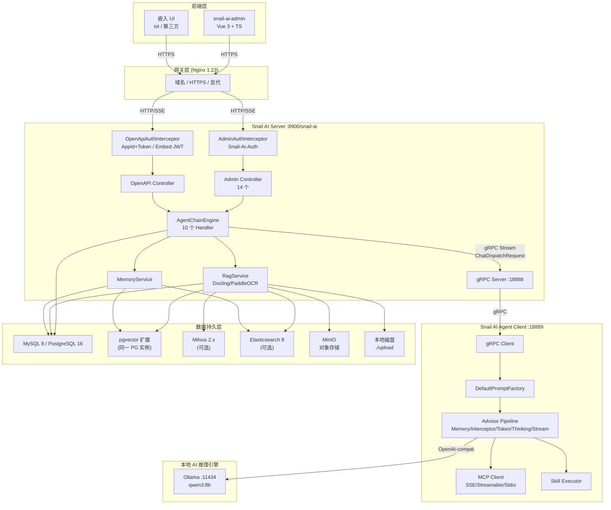
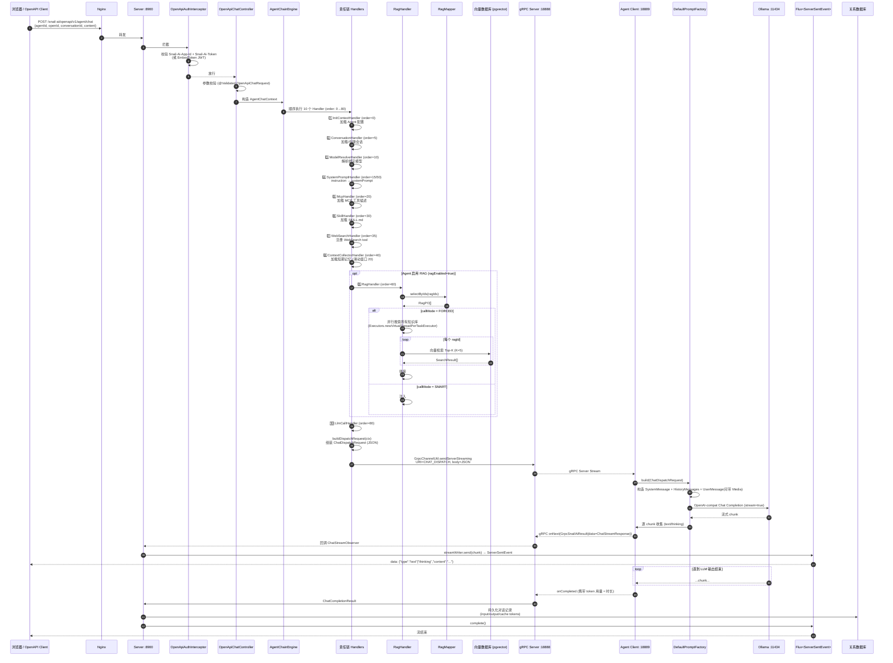

# 01 · 技术架构设计文档

> 项目：Snail AI · 基于 Spring Boot 4 + Spring AI 的多模型、多 Agent 管理平台
> 适用版本：1.1.1+ · 文档基于当前 `main` 分支源码整理

---

## 目录

1. [技术栈选型说明](#1-技术栈选型说明)
2. [分层架构描述](#2-分层架构描述)
3. [核心流程图](#3-核心流程图)
4. [AI 调度与管理策略](#4-ai-调度与管理策略)

---

## 1. 技术栈选型说明

Snail AI 采用 **Server–Agent 分布式双进程** 设计：Server 负责业务编排、模型调度、RAG 与记忆；Agent Client 负责模型调用、MCP/Skill 工具执行。前端可以独立部署，也可以嵌入到 iot 等已有系统中。

### 1.1 整体技术矩阵

| 类别 | 技术/框架 | 用途 | 关键配置/版本 |
|------|----------|------|----------------|
| **前端（管理端）** | Vue 3 + TypeScript + Vite | 后台管理界面（独立仓库 `snail-ai-admin`） | Naive UI、VitePress 文档站 |
| **前端（嵌入 UI）** | Vue 3 + TypeScript（构建产物内嵌） | 给第三方系统嵌入的对话 UI（如 iot 嵌入 `/snail-chat/`） | 通过 `/openapi/v1/embed-token` 颁发 JWT |
| **Java 后端框架** | Spring Boot 4 | 服务端与 Agent 端的统一容器 | JDK 21+ |
| **AI 编排** | Spring AI + 自研 Advisor/Chain | Chat、Embedding、Rerank 调用；责任链 | `spring-ai-*` 系列 |
| **服务间通信** | gRPC（自研统一信封协议） | Server ↔ Agent Client 双向流 | 端口 `12900`（Server gRPC） |
| **API 网关/反向代理** | Nginx 1.23 | 生产环境域名、HTTPS、跨域 | `script/docker/nginx/` |
| **本地 AI 推理引擎** | Ollama 0.5.7+（OpenAI-compatible） | 提供 `qwen3:8b` 等本地 Chat 模型 | 端口 `11434` |
| **可选 LLM** | OpenAI / Claude / Qwen / DeepSeek / Gemini / Zhipu（火山/智谱） | 通过 OpenAI-compatible 端点接入 | 模型配置表 `sai_model_config` |
| **关系型数据库** | PostgreSQL 16+（默认） / MySQL 8.0+（可选） | 用户、Agent、对话、知识库元数据等结构化数据 | HikariCP 连接池（max 20） |
| **向量数据库** | PostgreSQL **pgvector** 扩展（默认）/ Milvus 2.x / Elasticsearch 8.x | 文档 Embedding、记忆向量存储 | 通过 `sai_store_instance` 配置多实例 |
| **全文检索** | Elasticsearch 8.x / PostgreSQL 内置全文 | RAG 检索的 BM25 通道 | 可选启用 |
| **文档解析** | Docling API（端口 `5100`） + PaddleOCR（端口 `8866`） | PDF/Word/Excel/PPT/图片 OCR | `SNAIL_AI_RAG_DOCLING_URL` |
| **文件存储** | 本地磁盘（默认 `./upload`）/ MinIO | 上传资源、附件、Skill 文件 | `storage-type: LOCAL/MINIO` |
| **数据库访问** | MyBatis-Plus | Mapper/PO/Service 持久层 | 全局逻辑删除 |
| **Web 框架** | Spring MVC（OpenAPI/Admin） + Reactor（响应式 SSE） | 同步 REST + 流式 `Flux<ServerSentEvent>` | 启用 JDK 21 虚拟线程 |
| **API 文档** | SpringDoc / Swagger | 自动生成 OpenAPI 3 描述 | `/v3/api-docs` |
| **JDK 特性** | Java 21 虚拟线程（Virtual Threads） | RAG 并行检索、高并发 SSE | `spring.threads.virtual.enabled=true` |
| **认证** | auth0 java-jwt（HMAC-SHA256） | Admin Token + OpenAPI Embed Token | Header `Snail-Ai-Auth` / `Snail-Ai-App-Id+Token` |

### 1.2 关键依赖（`pom.xml` 摘录）

- **Spring Boot 4**：服务端基础容器
- **Spring AI**：`spring-ai-openai`、`spring-ai-reactor`、`spring-ai-prompt`、`spring-ai-advisors`
- **MyBatis-Plus 3.5+**：ORM + LambdaQuery
- **grpc-netty / grpc-stub / protobuf-java**：gRPC 双向流
- **Hutool / Lombok / MapStruct**：工具与对象映射
- **MinIO Java SDK**：对象存储
- **auth0 java-jwt**：JWT 颁发与校验
- **pgvector-java / milvus-sdk-java / elasticsearch-java**：多向量库适配

> 关于 Claude/Gemini/Ollama/火山引擎等：当前实现以 **OpenAI-compatible** 端点统一接入，因此它们并不作为独立一等 Provider 出现，而是通过 OpenAI 兼容适配层接入。

---

## 2. 分层架构描述

Snail AI 的代码严格遵循 **接入层 → 业务逻辑层 → AI 能力层 → 数据持久层** 的四层架构，结合 **Server–Agent 分布式双进程**，外加独立的 **外部依赖层**：

### 2.1 分层职责

| 层级 | 模块/目录 | 职责 | 关键组件 |
|------|-----------|------|----------|
| **接入层 (Access)** | `snail-ai-server-admin` / `snail-ai-server-openapi` | HTTP/SSE 入口、参数校验、统一鉴权、统一响应包装 | `OpenApiChatController`、`AgentController`、`OpenApiAuthInterceptor` |
| **业务逻辑层 (Business)** | `snail-ai-server-features`（`feature-agent`、`feature-rag`、`feature-memory`、`feature-resource`、`feature-skill`） | 责任链编排、业务规则、对话/知识库/记忆/技能的服务编排 | `AgentChainEngine`、`AgentChatHandler`（10 个 Handler）、`RagService`、`SkillService` |
| **AI 能力层 (AI Capability)** | `snail-ai-models`（`chat`/`embedding`/`rerank`）+ `snail-ai-agent-executor` | 模型调用适配、Prompt 构造、Advisor 流水线、MCP 工具执行 | `DefaultPromptFactory`、`ClientChatExecutor`、`Advisor 流水线` |
| **数据持久层 (Persistence)** | `snail-ai-server-persistence` | MyBatis-Plus Mapper + PO + Service，封装对 MySQL/PostgreSQL 的操作 | `AgentMapper`、`RagMapper`、`UserMapper`、`ClientNodeMapper` |
| **共享基础层 (Commons)** | `snail-ai-commons`（`core`/`grpc`/`domain`） | 常量、枚举、DTO、gRPC Proto、通用工具 | `OpenApiPathConstants`、`ChatDispatchRequest`、`snail_ai_grpc_service.proto` |
| **启动层 (Bootstrap)** | `snail-ai-starter` | Spring Boot 入口、`application.yml`、自动配置 | `bootstrap class`、`static-locations: classpath:admin/` |

### 2.2 Server / Agent 双进程职责

| 进程 | 端口 | 职责 | 不能做 |
|------|------|------|---------|
| **Server（`snail-ai-server`）** | HTTP `8900`（context-path `/snail-ai`）/ gRPC `18888` | 业务编排、责任链、知识库管理、记忆管理、应用/客户端节点管理、Admin/OpenAPI 鉴权 | 不直接调用大模型 API |
| **Agent Client（`snail-ai-agent`）** | gRPC `18889` | 通过 gRPC 连接 Server、调用本地/远程大模型、执行 MCP/Skill 工具、流式回传结果 | 不存储业务数据 |

### 2.3 Maven 模块依赖

```text
snail-ai-starter
└── snail-ai-server
    ├── snail-ai-server-admin       (管理后台 REST)
    ├── snail-ai-server-openapi     (对外 OpenAPI + SSE)
    ├── snail-ai-server-features    (feature-agent / feature-rag / feature-memory …)
    └── snail-ai-server-persistence (MyBatis-Plus)
├── snail-ai-agent                  (Client 启动 + Executor + OpenAPI 适配)
├── snail-ai-models                 (Chat / Embedding / Rerank)
└── snail-ai-commons                (core / grpc / domain / util)
```

---

## 3. 核心流程图

### 3.1 图 1：系统整体组件架构图



### 3.2 图 2：用户发起 AI 对话的核心时序图（含 RAG + SSE）

> 本图涵盖：前端请求 → Admin/OpenAPI 鉴权 → 责任链 → RAG 检索 → gRPC 分发 → 本地 LLM 调用 → SSE 流式回传 → 对话记录持久化



#### 关键时序点说明

| 步骤 | 文件/类 | 说明 |
|------|---------|------|
| 鉴权 | `OpenApiAuthInterceptor` | `Snail-Ai-App-Id` + `Snail-Ai-Token`（或 Embed JWT）；不通过则 401 |
| 责任链入口 | `OpenApiChatController#chat` | `@PostMapping(produces=TEXT_EVENT_STREAM_VALUE)` 返回 `Flux<ServerSentEvent>` |
| RAG 并行 | `RagHandler#parallelSearch` | `Executors.newVirtualThreadPerTaskExecutor()` 虚拟线程并行检索多个知识库 |
| 上下文注入 | `SystemPromptHandler` + `RagHandler` | RAG 把检索结果拼到 systemPrompt 末尾 |
| 模型分发 | `LlmCallHandler#handle` → `GrpcChannelUtil.sendServerStreaming` | gRPC 流式调用 `UriConstants.CHAT_DISPATCH` |
| 客户端组装 | `DefaultPromptFactory#build` | 构造 `Prompt(systemPrompt, history, userMessage, media)` |
| 流式回传 | `ChatStreamResponse.text(sid, text)` | 通过 SSE `text`/`thinking` 事件推到前端 |
| 持久化 | `ChatResultPersistService` | 写入 `sai_agent_conversation_record`（含 token 用量） |

---

## 4. AI 调度与管理策略

### 4.1 模型调度：Server ↔ Agent Client 分布式路由

Snail AI 的模型调用 **不在 Server 上直接发生**，而是通过 gRPC 转发到 Agent Client 节点执行。Server 端依据 `sai_client_node` 表的 **路由策略** + **心跳活跃度** + **并发上限** 进行选择：

| 路由策略 | `route_strategy` 值 | 行为 |
|----------|---------------------|------|
| **最小负载 (LEAST_LOAD)** | 默认 | 选择 `active_chats` 最小的 Client 节点 |
| **轮询 (ROUND_ROBIN)** | 配置切换 | 依次选择 |
| **加权 (WEIGHTED)** | 配置切换 | 按 `labels` 中的权重字段分发 |
| **粘性 (STICKY)** | 配置切换 | 同一 `conversationId` 始终路由到首次选中的节点 |

**关键表字段（`sai_client_node`）：**

```text
host_id           # 客户端实例唯一 ID
host_ip           # 注册 IP
grpc_port         # gRPC 监听端口（默认 18889）
max_concurrent    # 最大并发对话数
active_chats      # 当前活跃对话数（Server 实时更新）
labels            # JSON 标签，用于加权路由
expire_dt         # 心跳过期时间（心跳续期）
online            # 在线状态（由心跳机制维护）
```

**心跳机制：** Agent Client 启动后每 30s 向 Server 发送一次心跳（`heartbeat-interval: 30s`），Server 刷新 `expire_dt`；超时未续期则 `online=false`，自动剔除出可用池。

### 4.2 本地推理引擎：Ollama + OpenAI-compatible

Snail AI 官方验证并推荐使用 **Ollama** 作为本地推理引擎（已在 `qwen3:8b` 上验证）。任何兼容 OpenAI Chat Completions 接口的服务（如 vLLM、LM Studio、LocalAI、Xinference）均可接入。

| 配置项 | 默认值 | 说明 |
|--------|--------|------|
| Ollama 监听端口 | `11434` | 容器化部署：`ollama/ollama:0.5.7`，`network_mode: host` |
| 适配方式 | OpenAI-compatible | `POST /v1/chat/completions`，无需修改代码 |
| 模型配置存储 | `sai_model_config` | `model_type=CHAT`、`api_endpoint=http://host.docker.internal:11434/v1` |
| 鉴权 | `api_key` 字段 | Ollama 通常无需 key，留空；其他兼容服务需填入 |

**Ollama 启动示例：**

```bash
docker run -d --name ollama \
  --network host \
  -v ollama-data:/root/.ollama \
  ollama/ollama:0.5.7

# 拉取模型（推荐 qwen3 系列，兼顾中文与推理）
docker exec -it ollama ollama pull qwen3:8b
docker exec -it ollama ollama pull nomic-embed-text   # 嵌入模型（可选）
```

**模型选型建议：**

| 模型 | 参数量 | 显存需求 | 推荐场景 |
|------|--------|----------|----------|
| `qwen3:8b` | 8B（4-bit 约 5GB） | 8GB+ | 中英文对话、推理、Agent 编排（官方默认验证） |
| `qwen3:14b` | 14B（4-bit 约 9GB） | 12GB+ | 更强推理与代码能力 |
| `qwen3:32b` | 32B（4-bit 约 20GB） | 24GB+ | 高质量复杂任务 |
| `deepseek-r1:8b` | 8B（推理模型） | 8GB+ | 数学/逻辑推理（思考过程较长） |
| `nomic-embed-text` | 137M | CPU 即可 | 英文 Embedding |
| `bge-m3` | 568M | CPU 即可 | 中英混合 Embedding（推荐） |

> **CPU 模式**：8B 模型在纯 CPU 推理速度约 5-15 token/s，适合开发与冒烟测试；生产建议 8GB+ 显存的 GPU。

### 4.3 上下文窗口（Context Window）管理

上下文由 Server 端 **责任链** 组装，传给 Agent Client 后由 Spring AI `Prompt` 渲染。

| 阶段 | 字段 | 缺省值 | 来源 |
|------|------|--------|------|
| **系统提示词** | `systemPrompt` | Agent.instruction；空时 `"You are a helpful AI assistant."` | `SystemPromptHandler` |
| **短期记忆** | `historyMessages` | 最近 20 条（`shortTermMemorySize` 可配） | `ContextCollectorHandler` |
| **长期记忆** | `memoryContext` | 召回 Top-K（按 `MemoryConfig.maxRecall`） | `MemoryInjectionAdvisor`（Client 端） |
| **RAG 知识** | 追加到 `systemPrompt` | Top-K=5（`resultCount` 可配） | `RagHandler` |
| **MCP/Skill 工具描述** | `tools` | 智能体绑定的 MCP/Skill | `McpHandler` / `SkillHandler` |
| **当前用户消息** | `userMessage` + `media` | 本轮 | 请求参数 |

**总组装顺序**（Client 端 `DefaultPromptFactory#build`）：

```text
[
  SystemMessage(systemPrompt),        # 角色 + 记忆 + RAG 知识 + 可用工具描述
  ...historyMessages (user/assistant),
  UserMessage(userMessage, media=[])  # 当前消息（可带图片/音频）
]
```

**上下文截断策略：**

- **滑动窗口**：超出 `shortTermMemorySize` 的最早消息被丢弃
- **Token 超限**：在 `ModelConfig` 中可配置 `maxTokens`；超出将由 Spring AI Provider 自动截断
- **RAG 知识注入**：以 `## Knowledge Base Reference` 形式拼到 systemPrompt 末尾，由 LLM 在生成时参考
- **长对话压缩**：通过长期记忆的 `MemoryInjectionAdvisor` 把关键事实向量化召回，避免重复占用窗口

### 4.4 并发处理策略

| 维度 | 策略 | 配置 |
|------|------|------|
| **HTTP 请求处理** | Tomcat NIO + **JDK 21 虚拟线程** | `spring.threads.virtual.enabled=true`（已在 `application.yml` 启用） |
| **RAG 多知识库并行检索** | 每个 ragId 一个虚拟线程 | `Executors.newVirtualThreadPerTaskExecutor()`（`RagHandler#parallelSearch`） |
| **SSE 流式响应** | Reactor `Flux<ServerSentEvent>` + 异步回调 `ChatStreamObserver` | 每个连接独立虚拟线程 |
| **Client 端模型调用** | Spring AI 异步 + Reactor 背压 | Provider 默认 streaming |
| **数据库连接池** | HikariCP，`max-pool-size=20` | `application.yml` |
| **Client 并发上限** | 每个 Agent 节点 `max_concurrent`（默认 16，可调） | `sai_client_node.max_concurrent` |
| **路由选择** | `LEAST_LOAD` 优先派发到 `active_chats` 最低节点 | `sai_app.route_strategy` |

**多 Agent Client 集群部署示意：**

```text
                    ┌─ Client-A (max=16) ──→ Ollama-A (本地 GPU)
Server ──gRPC──────┼─ Client-B (max=16) ──→ Ollama-B (云端 GPU)
(LEAST_LOAD)       └─ Client-C (max=8)  ──→ OpenAI API
```

### 4.5 上下文与成本控制

| 措施 | 说明 |
|------|------|
| **Temperature 默认 0.7** | 平衡生成质量与多样性，可在 ModelConfig 调整 |
| **`max_tokens` 默认 4096** | 限制单次输出长度 |
| **流式输出 (SSE)** | 用户可在生成中途取消，避免无效计算 |
| **Token 统计上报** | `ChatResultPersistService` 持久化 `input_tokens` / `output_tokens` / `cache_tokens` |
| **幻觉抑制** | RAG 强制模式（`FORCED`）要求 LLM 基于参考资料回答；可在 instruction 中追加约束 |

---

## 5. 附：典型配置示例

### 5.1 已验证可用的最小配置

```yaml
# application.yml
server:
  port: 8900
  servlet:
    context-path: /snail-ai

spring:
  threads:
    virtual:
      enabled: true
  datasource:
    driver-class-name: org.postgresql.Driver
    url: jdbc:postgresql://localhost:5432/snail_ai?allowMultiQueries=true
    username: postgres
    password: postgres

snail-ai:
  server:
    grpc-port: 18888
  memory:
    short-term:
      store-type: memory
```

### 5.2 已验证可用的 Ollama 配置（snail-ai-admin → 模型管理）

```text
名称:           qwen3-8b-local
provider:       OpenAI
endpoint:       http://host.docker.internal:11434/v1
api_key:        （留空）
model_name:     qwen3:8b
model_type:     CHAT
scope:          GLOBAL
is_default:     true
is_enabled:     true
```

---

## 6. 相关源码位置

| 文件 | 作用 |
|------|------|
| `snail-ai-starter/src/main/resources/application.yml` | 主配置文件 |
| `pom.xml` | Maven 顶层依赖 |
| `script/docker/docker-compose.yml` | 容器化部署 |
| `snail-ai-commons/snail-ai-commons-grpc/src/main/proto/snail_ai_grpc_service.proto` | gRPC 协议定义 |
| `snail-ai-server/snail-ai-server-features/snail-ai-feature-agent/src/main/java/.../chain/` | 10 个责任链 Handler |
| `snail-ai-server/snail-ai-server-openapi/src/main/java/.../controller/OpenApiChatController.java` | SSE 对话入口 |
| `snail-ai-agent/snail-ai-agent-executor/snail-ai-agent-executor-core/src/main/java/.../grpc/handler/ChatDispatchStreamingHandler.java` | gRPC 流式分发入口 |
| `snail-ai-agent/snail-ai-agent-executor/snail-ai-agent-executor-core/src/main/java/.../executor/prompt/DefaultPromptFactory.java` | Prompt 工厂 |