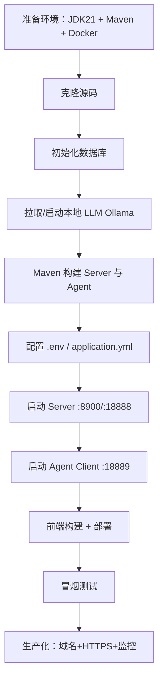

# 03 · 项目从零搭建与部署指南

> 配套文档：[01-技术架构设计](01-技术架构设计.md) · [02-启动验证与功能说明](02-启动验证与功能说明.md)
> 本文基于 `script/docker/docker-compose.yml` 与实际构建脚本，描述 **从零搭建 → 容器化部署 → 故障排查** 的完整 SOP。

---

## 目录

1. [搭建 SOP 流程](#1-搭建-sop-流程)
2. [容器化部署方案](#2-容器化部署方案)
3. [常见问题排查（Troubleshooting）](#3-常见问题排查troubleshooting)

---

## 1. 搭建 SOP 流程

### 1.1 整体流程图



### 1.2 Step 1：环境准备

```bash
# 1. JDK 21+
java -version
# openjdk version "21.x.x" 2024-xx-xx

# 2. Maven 3.8+
mvn -version

# 3. Docker 20.10+
docker --version
docker compose version

# 4. 安装 pnpm（前端构建用）
npm install -g pnpm@10
```

### 1.3 Step 2：克隆源码与子模块

```bash
mkdir -p /workspace
cd /workspace
git clone https://gitee.com/opensnail/snail-ai.git
cd snail-ai

# 前端是独立仓库
git clone https://gitee.com/opensnail/snail-ai-admin.git
```

### 1.4 Step 3：项目骨架说明

```text
snail-ai/
├── pom.xml                          # Maven 顶层（聚合 5 个模块）
├── snail-ai-commons/                # 共享基础（DTO / Proto / 常量）
│   ├── snail-ai-commons-core
│   └── snail-ai-commons-grpc
├── snail-ai-models/                 # 模型能力（Chat/Embedding/Rerank）
│   ├── snail-ai-models-chat
│   ├── snail-ai-models-embedding
│   └── snail-ai-models-rerank
├── snail-ai-server/                 # 服务端（业务核心）
│   ├── snail-ai-server-admin        # Admin REST API
│   ├── snail-ai-server-openapi      # OpenAPI + SSE
│   ├── snail-ai-server-features     # 业务功能（agent/rag/memory/...）
│   └── snail-ai-server-persistence  # MyBatis-Plus
├── snail-ai-agent/                  # Agent Client
│   ├── snail-ai-agent-chat
│   ├── snail-ai-agent-executor
│   └── snail-ai-agent-openapi       # OpenAPI 适配 SDK（给第三方调用）
└── snail-ai-starter/                # Spring Boot 启动入口
    └── src/main/resources/application.yml
```

### 1.5 Step 4：核心依赖引入

> 实际项目已在 `pom.xml` 中定义；新人只需修改 `<properties>` 即可。

```xml
<!-- pom.xml 关键 properties -->
<properties>
    <java.version>21</java.version>
    <maven.compiler.source>21</maven.compiler.source>
    <maven.compiler.target>21</maven.compiler.target>
    <project.build.sourceEncoding>UTF-8</project.build.sourceEncoding>
    <spring-boot.version>4.0.0</spring-boot.version>
    <spring-ai.version>2.0.0</spring-ai.version>
    <mybatis-plus.version>3.5.9</mybatis-plus.version>
    <grpc.version>1.65.1</grpc.version>
</properties>
```

### 1.6 Step 5：AI 接口封装（Spring AI Chat Client）

> 所有 Chat/Embedding/Rerank 调用都通过 Spring AI `ChatClient`，统一走 OpenAI-compatible 端点。

**示例：** 调用 Ollama 上的 qwen3:8b

```java
@Service
@RequiredArgsConstructor
public class OllamaChatService {

    private final ChatClient chatClient;

    public Flux<String> chatStream(String prompt) {
        return chatClient.prompt()
                .user(prompt)
                .stream()
                .content();  // 逐 chunk 输出
    }
}
```

**ModelConfig 表配置：**

| 字段 | 值 |
|------|-----|
| `model_type` | CHAT |
| `model_name` | qwen3:8b |
| `provider` | OpenAI（兼容端点） |
| `api_endpoint` | `http://host.docker.internal:11434/v1` |
| `api_key` | `ollama`（留空会被拒绝，可填任意非空） |
| `is_enabled` | true |

### 1.7 Step 6：数据库连接配置

> 通过环境变量注入，不要硬编码到 `application.yml`。

**PostgreSQL（推荐）：**

```yaml
spring:
  datasource:
    driver-class-name: org.postgresql.Driver
    url: jdbc:postgresql://localhost:5432/snail_ai?allowMultiQueries=true
    username: postgres
    password: postgres
```

**MySQL：**

```yaml
spring:
  datasource:
    driver-class-name: com.mysql.cj.jdbc.Driver
    url: jdbc:mysql://localhost:3306/snail_ai?useSSL=false&allowPublicKeyRetrieval=true&characterEncoding=utf8&useUnicode=true
    username: root
    password: 123456
```

### 1.8 Step 7：构建与启动

```bash
# 一次性构建所有模块
cd /workspace/snail-ai
mvn clean install -DskipTests -T 1C

# 启动 Server
cd snail-ai-starter
mvn spring-boot:run

# 新终端启动 Agent
cd /workspace/snail-ai/snail-ai-agent-example
mvn spring-boot:run
```

---

## 2. 容器化部署方案

> 以下为 **生产级最小化 Compose**（与 `script/docker/docker-compose.yml` 一致）。

### 2.1 完整 `docker-compose.yml`（核心配置示例）

```yaml
# 文件：docker-compose.yml
version: '3.8'

networks:
  snail-net:
    driver: bridge

volumes:
  pg_data:
  ollama_data:
  minio_data:

services:
  # ============================================================
  # 1. PostgreSQL（含 pgvector 扩展）
  # ============================================================
  postgres:
    image: pgvector/pgvector:pg16
    container_name: postgres
    environment:
      POSTGRES_USER: postgres
      POSTGRES_PASSWORD: postgres
      POSTGRES_DB: snail_ai
    ports:
      - "5432:5432"
    volumes:
      - pg_data:/var/lib/postgresql/data
      - ./script/sql:/docker-entrypoint-initdb.d   # 自动初始化
    networks:
      - snail-net
    healthcheck:
      test: ["CMD-SHELL", "pg_isready -U postgres"]
      interval: 10s
      timeout: 5s
      retries: 5
    restart: unless-stopped

  # ============================================================
  # 2. Ollama（本地大模型推理）
  # ============================================================
  ollama:
    image: ollama/ollama:0.5.7
    container_name: ollama
    network_mode: host                   # 共享宿主机网络，方便调用宿主 GPU
    volumes:
      - ollama_data:/root/.ollama
    environment:
      - OLLAMA_KEEP_ALIVE=24h
      - OLLAMA_HOST=0.0.0.0:11434
    restart: unless-stopped

  # ============================================================
  # 3. Snail AI Server（业务核心）
  # ============================================================
  snail-ai-server:
    build:
      context: ../snail-ai-starter
      dockerfile: ../script/docker/Dockerfile
    image: snail-ai/server:1.1.1
    container_name: snail-ai-server
    network_mode: host                   # 与本机 Ollama 互通
    depends_on:
      postgres:
        condition: service_healthy
    environment:
      JAVA_OPTS: >-
        -Xms2g -Xmx4g
        -XX:+UseG1GC -XX:MaxGCPauseMillis=200
        -XX:+HeapDumpOnOutOfMemoryError
        -XX:HeapDumpPath=/app/logs/heapdump.hprof
        -Dspring.profiles.active=prod
        -Dspring.datasource.driver-class-name=org.postgresql.Driver
        -Dspring.datasource.url=jdbc:postgresql://localhost:5432/snail_ai?allowMultiQueries=true
        -Dspring.datasource.username=postgres
        -Dspring.datasource.password=postgres
        -Dspring.threads.virtual.enabled=true
        -Dsnail-ai.server.grpc-port=18888
        -Dsnail-ai.crypto.secret-key=0123456789abcdef0123456789abcdef
        -Dsnail-ai.crypto.iv=fedcba9876543210fedcba9876543210
    volumes:
      - ./logs/server:/app/logs
      - ./upload:/app/upload
    restart: unless-stopped

  # ============================================================
  # 4. Snail AI Agent Client（模型调用与工具执行）
  # ============================================================
  snail-ai-agent:
    build:
      context: ../snail-ai-agent-example
      dockerfile: ../script/docker/Dockerfile
    image: snail-ai/agent:1.1.1
    container_name: snail-ai-agent
    network_mode: host
    depends_on:
      - snail-ai-server
    environment:
      JAVA_OPTS: >-
        -Xms512m -Xmx2g
        -Dsnail-ai.server.host=127.0.0.1
        -Dsnail-ai.server.port=18888
        -Dsnail-ai.agent.host=0.0.0.0
        -Dsnail-ai.agent.port=18889
        -Dsnail-ai.app-id=snail-ai-agent-demo
        -Dsnail-ai.token=SAI_0d0f844da152475999ab1db2f8131210
    restart: unless-stopped

  # ============================================================
  # 5. Nginx（前端 + 反代）
  # ============================================================
  nginx:
    image: nginx:1.23.4
    container_name: snail-ai-nginx
    network_mode: host
    volumes:
      - ./nginx/conf/nginx.conf:/etc/nginx/nginx.conf:ro
      - ./nginx/conf/vhost:/etc/nginx/conf/vhost:ro
      - ./nginx/html:/usr/share/nginx/html:ro
      - ./nginx/cert:/etc/nginx/cert:ro
    depends_on:
      - snail-ai-server
    restart: unless-stopped
```

### 2.2 启动与初始化

```bash
# 1. 启动基础组件
docker compose up -d postgres ollama

# 2. 拉取模型
docker exec -it ollama ollama pull qwen3:8b

# 3. 等待 DB 初始化完成（schema 自动跑）
docker compose logs -f postgres
# 看到 "database system is ready to accept connections" 后继续

# 4. 启动 Server + Agent
docker compose up -d --build snail-ai-server snail-ai-agent

# 5. 启动前端反代
docker compose up -d nginx

# 6. 查看状态
docker compose ps

# 7. 健康检查
curl http://localhost:8900/snail-ai/actuator/health
curl http://localhost:18888   # gRPC（用 grpc_cli 或 grpcurl 测试）
curl http://localhost:11434/api/tags   # Ollama
```

### 2.3 关键设计说明

| 设计点 | 原因 |
|--------|------|
| **`network_mode: host`** | Ollama 访问宿主机 GPU；Server/Agent 与 Ollama 互联互通，避免端口转发麻烦 |
| **`JAVA_OPTS` 全注入** | 敏感配置不进镜像，便于多环境复用同一镜像 |
| **`pgvector/pgvector:pg16`** | 默认即带 pgvector 扩展，无需额外安装 |
| **Ollama 独立 volume** | `ollama_data` 持久化模型，避免容器重建后重新下载 |
| **`depends_on: condition: service_healthy`** | 确保 Postgres 就绪后再启动 Server |

---

## 3. 常见问题排查（Troubleshooting）

> 以下是搭建与运行「本地 AI + Java」项目时 **最容易遇到的 5 个致命问题**，每个都给出代码级/配置级解决方案。

---

### ❌ 问题 1：Ollama 跨域 CORS 报错（前端 JS 直接调用失败）

**现象：**

```text
浏览器控制台：
Access to fetch at 'http://localhost:11434' from origin 'http://localhost:5173'
has been blocked by CORS policy: No 'Access-Control-Allow-Origin' header...
```

**原因：** Ollama 默认 **不开启** CORS，前端无法直接跨域请求 `http://localhost:11434`。

**✅ 推荐方案：让前端通过 Snail AI OpenAPI 调用，而不是直连 Ollama**

```typescript
// 推荐：通过 Snail AI OpenAPI 调用 LLM（自动鉴权 + RAG + 记忆）
async function chat(content: string) {
  const resp = await fetch('http://localhost:8900/snail-ai/openapi/v1/agent/chat', {
    method: 'POST',
    headers: {
      'Content-Type': 'application/json',
      'Snail-Ai-App-Id': 'snail-ai-agent-demo',
      'Snail-Ai-Token': 'SAI_0d0f844da152475999ab1db2f8131210',
    },
    body: JSON.stringify({
      agentId: 1,
      openId: 'demo-user',
      conversationId: 'demo-conv-001',
      content,
    }),
  });
  // 解析 SSE...
}
```

**⚠️ 仅在调试时**允许 Ollama CORS（不推荐生产）：

```bash
# 设置环境变量后重启 Ollama
export OLLAMA_ORIGINS="*"
ollama serve

# 或 Docker
docker run -d --name ollama -p 11434:11434 \
  -e OLLAMA_ORIGINS="*" \
  -v ollama-data:/root/.ollama \
  ollama/ollama:0.5.7
```

---

### ❌ 问题 2：显存溢出 OOM（运行 8B+ 模型时崩溃）

**现象：**

```text
ollama serve 日志：
CUDA error: out of memory
model requires more VRAM than available
```

或 Java 端：

```text
java.lang.OutOfMemoryError: Direct buffer memory
```

**原因：** 模型权重 + KV cache 超过显存；Java 进程默认堆/直接内存不足。

**✅ 方案 A：换更小的模型**

```bash
# 8GB 显存 → 4-bit 8B 模型
docker exec -it ollama ollama pull qwen3:8b

# 16GB 显存 → 14B 或 8B-q8
docker exec -it ollama ollama pull qwen3:14b

# 无 GPU → 7B CPU 模式
OLLAMA_NUM_GPU=0 docker exec -it ollama ollama run qwen3:8b
```

**✅ 方案 B：调整 Ollama 显存分配**

```bash
# 限制单模型最大显存（单位字节）
OLLAMA_MAX_VRAM=6GiB ollama serve

# 限制并行加载模型数（默认 1）
OLLAMA_MAX_LOADED_MODELS=1
```

**✅ 方案 C：调整 Java JVM 参数**

```yaml
# docker-compose.yml
environment:
  JAVA_OPTS: >-
    -Xms2g -Xmx4g
    -XX:MaxDirectMemorySize=1g
    -XX:+UseG1GC -XX:MaxGCPauseMillis=200
    -XX:+HeapDumpOnOutOfMemoryError
    -XX:HeapDumpPath=/app/logs/heapdump.hprof
```

**✅ 方案 D：监控显存**

```bash
# NVIDIA GPU
nvidia-smi -l 1

# Apple Silicon (MPS)
sudo powermetrics --samplers gpu_power -i 1000
```

---

### ❌ 问题 3：Spring AI 依赖冲突（启动报 ClassNotFoundException）

**现象：**

```text
***************************
APPLICATION FAILED TO START
***************************

Description:
An attempt was made to call a method that does not exist.
The attempt was made from the following location:
    org.springframework.ai.openai.OpenAiChatClient.<init>(...)
```

或：NoClassDefFoundError / LinkageError。

**原因：** Spring AI 与 Spring Boot 版本不匹配；或多个 `spring-ai-*` 模块传递依赖冲突。

**✅ 方案 A：锁定版本组合**

```xml
<!-- pom.xml -->
<properties>
    <spring-boot.version>4.0.0</spring-boot.version>
    <spring-ai.version>2.0.0</spring-ai.version>
</properties>

<dependencyManagement>
    <dependencies>
        <dependency>
            <groupId>org.springframework.boot</groupId>
            <artifactId>spring-boot-dependencies</artifactId>
            <version>${spring-boot.version}</version>
            <type>pom</type>
            <scope>import</scope>
        </dependency>
        <dependency>
            <groupId>org.springframework.ai</groupId>
            <artifactId>spring-ai-bom</artifactId>
            <version>${spring-ai.version}</version>
            <type>pom</type>
            <scope>import</scope>
        </dependency>
    </dependencies>
</dependencyManagement>
```

**✅ 方案 B：排除冲突依赖**

```xml
<dependency>
    <groupId>com.example</groupId>
    <artifactId>third-party-llm</artifactId>
    <version>1.0.0</version>
    <exclusions>
        <exclusion>
            <groupId>org.springframework.ai</groupId>
            <artifactId>spring-ai-core</artifactId>
        </exclusion>
    </exclusions>
</dependency>
```

**✅ 方案 C：清理本地仓库缓存**

```bash
mvn dependency:purge-local-repository -DreResolve=false
mvn clean install -U -DskipTests
```

**✅ 方案 D：用 `mvn dependency:tree` 定位**

```bash
mvn dependency:tree -Dincludes=org.springframework.ai
# 找出哪个模块引入了冲突版本
```

---

### ❌ 问题 4：SSE 流式连接意外断开

**现象：**

- 前端 EventSource / fetch 收到 `net::ERR_INCOMPLETE_CHUNKED_ENCODING`
- 流中途 TCP 连接被强制关闭
- 多轮对话中只有第一轮正常，第二轮开始就断

**原因：** 默认 Tomcat / Nginx 缓冲与超时配置会强制关闭长连接。

**✅ 方案 A：Spring Boot 配置（`application.yml`）**

```yaml
server:
  # SSE 超时设为无限（单位 ms）
  reactor.netty:
    connection-timeout: 60s
spring:
  webflux:
    # 不使用 WebFlux 时此节可省略
  mvc:
    async:
      request-timeout: -1       # 异步请求永不超时

# Tomcat 专属配置
server.tomcat.connection-timeout=120s
server.tomcat.keep-alive-timeout=120s
```

**✅ 方案 B：Nginx 反代配置（关键）**

```nginx
# /etc/nginx/conf/vhost/snailai-server.conf
location /snail-ai/openapi/v1/agent/chat {
    proxy_pass http://127.0.0.1:8900;
    
    # ⭐ 关键 1：禁用缓冲（实时推送）
    proxy_buffering off;
    proxy_cache off;
    
    # ⭐ 关键 2：禁用请求/响应缓冲
    proxy_request_buffering off;
    
    # ⭐ 关键 3：超时设为 0（永不超时）
    proxy_read_timeout 3600s;
    proxy_send_timeout 3600s;
    proxy_connect_timeout 60s;
    
    # ⭐ 关键 4：HTTP/1.1 + 清理 hop-by-hop 头
    proxy_http_version 1.1;
    proxy_set_header Connection "";
    proxy_set_header X-Accel-Buffering no;   # 强制禁用 nginx 缓冲
    proxy_set_header Host $host;
    
    # ⭐ 关键 5：流式响应 Content-Type
    proxy_set_header Accept text/event-stream;
}
```

**✅ 方案 C：Java 代码层**

```java
// 确保 @PostMapping 设置了正确的 produces
@PostMapping(value = OPEN_API_AGENT_CHAT,
             produces = MediaType.TEXT_EVENT_STREAM_VALUE)
public Flux<ServerSentEvent<String>> chat(@RequestBody @Validated OpenApiChatRequest request) {
    return openApiChatService.chatStream(request).map(this::toServerSentEvent);
}

// 定期发送心跳（防中间设备超时切断）
@GetMapping(value = "/heartbeat", produces = MediaType.TEXT_EVENT_STREAM_VALUE)
public Flux<ServerSentEvent<String>> heartbeat() {
    return Flux.interval(Duration.ofSeconds(15))
               .map(i -> ServerSentEvent.builder("ping").build());
}
```

**✅ 方案 D：前端 fetch 处理重连**

```typescript
async function chatWithRetry(payload: any, maxRetries = 3) {
  for (let attempt = 0; attempt < maxRetries; attempt++) {
    try {
      const resp = await fetch(API_URL, {
        method: 'POST',
        headers: { /* ... */ },
        body: JSON.stringify(payload),
      });
      if (!resp.ok) throw new Error(`HTTP ${resp.status}`);
      // 处理流...
      return;
    } catch (e) {
      console.warn(`Attempt ${attempt + 1} failed:`, e);
      if (attempt === maxRetries - 1) throw e;
      await new Promise(r => setTimeout(r, 1000 * (attempt + 1))); // 指数退避
    }
  }
}
```

---

### ❌ 问题 5：向量数据库连接超时 / 维度不匹配

**现象 A：连接超时**

```text
org.postgresql.core.ConnectionFactory.createConnection
  报错：Connection timed out: connect
```

**✅ 方案：检查网络 + 配置**

```yaml
# application.yml
spring.datasource:
  url: jdbc:postgresql://<正确IP>:5432/snail_ai
  hikari:
    connection-timeout: 30000      # 30s（默认足够）
    maximum-pool-size: 20
    minimum-idle: 5
    # 启用 PG 防火墙检查
    connection-test-query: SELECT 1

# pgvector 验证
# psql -U postgres -d snail_ai -c "SELECT extname FROM pg_extension WHERE extname='vector';"
```

**现象 B：维度不匹配**

```text
ERROR: expected 768 dimensions, not 1024
```

**✅ 方案：保证 Embedding 模型与向量库维度一致**

```yaml
# sai_rag 表里的维度必须 = Embedding 模型输出维度
# 例如 bge-m3 → 1024 / bge-small-zh → 512 / nomic-embed-text → 768

# 修改 RAG 配置（管理后台）：
# 知识库 → 编辑 → 向量维度：1024（与 Embedding 模型匹配）

# 或在数据库直接修改
# UPDATE sai_rag SET dimension_of_vector_model = 1024 WHERE id = 1;

# ⚠️ 已写入的向量需要重建
TRUNCATE TABLE sai_rag_chunk;
-- 重新触发文档处理
```

**✅ 方案：Milvus 连接**

```yaml
# application.yml
snail-ai:
  rag:
    vector-store:
      milvus:
        host: localhost
        port: 19530
        user: root
        password: milvus-password
        database: snail_ai
```

**✅ 方案：Elasticsearch 连接**

```bash
# ES 健康检查
curl http://localhost:9200/_cluster/health?pretty

# 索引创建
PUT /snail_ai_chunks
{
  "mappings": {
    "properties": {
      "content": { "type": "text" },
      "embedding": { "type": "dense_vector", "dims": 1024 }
    }
  }
}
```

---

### 附录：其他高频问题速查

| 现象 | 原因 | 解决方案 |
|------|------|----------|
| `UnsupportedClassVersionError` | JDK < 21 | 升级到 JDK 21+ |
| `Communications link failure` | DB 未启动 / 防火墙 | `pg_isready` / `mysqladmin ping` |
| `gRPC UNAVAILABLE` | Server 未起 / 端口被占用 | `nc -zv localhost 18888` |
| `API Key 401` | 加密密钥不一致 | 检查 `SNAIL_AI_CRYPTO_KEY` / `SNAIL_AI_CRYPTO_IV` 与录入时一致 |
| `Heap OOM` | 文档过大 / 并发过高 | `MAT` 分析 + 调小文档 + 加内存 |
| `429 Too Many Requests` | 模型限流 | 降低并发 / 申请更高配额 |
| Ollama 模型下载慢 | 网络模型下载 | 设置 `OLLAMA_MODELS=https://hf-mirror.com/{username}/{repo}` |
| 前端 `pnpm install` 卡住 | npm 镜像 | `pnpm config set registry https://registry.npmmirror.com` |

---

## 4. 故障排查工具箱

```bash
# 服务状态
docker compose ps
ss -tlnp | grep -E "8900|18888|11434|5432|3306"

# 健康检查
curl http://localhost:8900/snail-ai/actuator/health
curl http://localhost:8900/snail-ai/actuator/health/db

# 实时日志
docker compose logs -f snail-ai-server --tail=100
docker compose logs -f ollama --tail=100

# JVM 运行时
jps -lv
jstat -gc <pid> 1000
jstack <pid> | head -100

# 数据库慢查询
psql -U postgres -d snail_ai -c "
  SELECT pid, now() - pg_stat_activity.query_start AS duration, query
  FROM pg_stat_activity
  WHERE state != 'idle' ORDER BY duration DESC LIMIT 20;"

# Ollama 状态
curl http://localhost:11434/api/tags
docker exec -it ollama ollama ps

# 资源监控
top -p $(pgrep -f snail-ai)
nvidia-smi -l 1
df -h
```

---

## 5. 相关源码位置

| 文件 | 作用 |
|------|------|
| `script/docker/docker-compose.yml` | 完整 Compose 定义 |
| `script/docker/Dockerfile` | Server / Agent 镜像构建 |
| `script/deploy/ci-setup.sh` | 一键安装 JDK/Maven/Node |
| `script/deploy/update-server.sh` | Server 更新脚本 |
| `script/deploy/update-agent.sh` | Agent 更新脚本 |
| `script/deploy/update-admin.sh` | 前端更新脚本 |
| `script/sql/snail_ai_schema_pgsql.sql` | PG 表结构（含默认数据） |
| `script/sql/snail_ai_schema.sql` | MySQL 表结构 |
| `docs/deploy/troubleshooting.md` | 完整故障排查手册（本文档的精简源） |
| `docs/deploy/docker.md` | 详细 Docker 部署文档 |