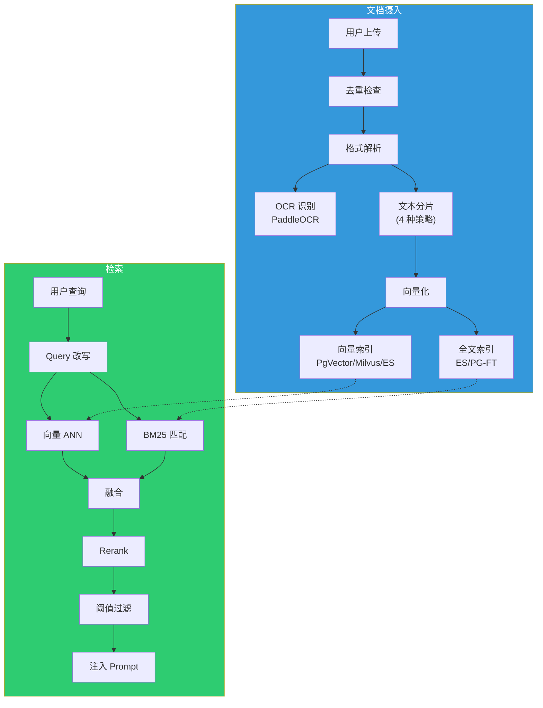
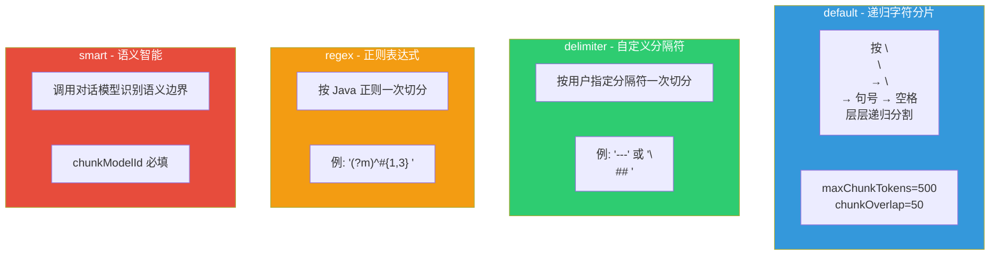
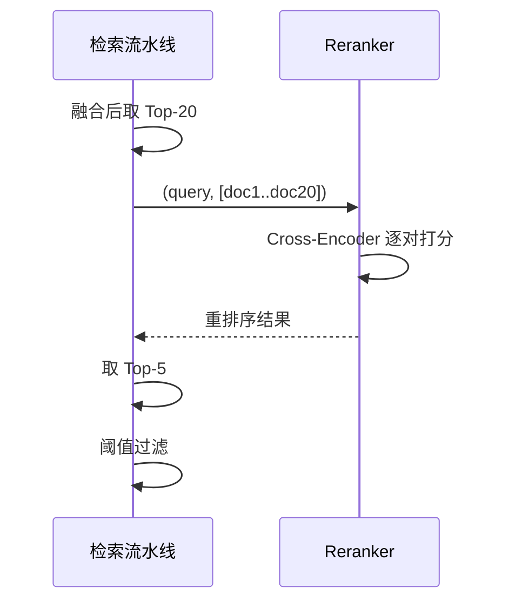

# AI 核心链路与 Prompt 设计文档

> 适用范围：Snail AI 全栈项目  
> 版本：v0.5.x  
> 作者：Snail AI 架构组  
> 配套源码目录：`snail-ai-server`、`snail-ai-agent`、`snail-ai-models`

---

## 目录

1. [模型选型与推理引擎配置](#1-模型选型与推理引擎配置)
2. [Prompt 模板库](#2-prompt-模板库)
3. [RAG 全链路设计](#3-rag-全链路设计)
4. [幻觉控制与后处理](#4-幻觉控制与后处理)
5. [附录：源码位置速查](#5-附录源码位置速查)

---

## 1. 模型选型与推理引擎配置

### 1.1 引擎抽象：OpenAI 兼容协议

Snail AI 通过 `snail-ai-models` 模块对底层推理引擎做了一层**协议级抽象**。所有模型（无论是 Ollama 本地模型、OpenAI、DeepSeek、Claude、Gemini 还是通义千问）都以 **OpenAI `/v1/chat/completions` 兼容格式**进行交互：

```java
// snail-ai-models/.../chat/ChatModelAdapter.java 抽象示意
public interface ChatModelAdapter {
    ChatResponse chat(ChatRequest request);                         // 同步
    void chatStream(ChatRequest request, StreamHandler handler);     // 流式
    String providerKey();    // openai / ollama / deepseek / ...
    String defaultEndpoint(); // http://localhost:11434/v1 ...
}
```

| 适配器 | providerKey | 默认 Endpoint | 备注 |
|--------|-------------|---------------|------|
| `OllamaChatAdapter` | `ollama` | `http://localhost:11434/v1` | 走 OpenAI 兼容层，无需独立 SDK |
| `OpenAiChatAdapter` | `openai` | `https://api.openai.com/v1` | 支持 Function Calling |
| `DeepSeekChatAdapter` | `deepseek` | `https://api.deepseek.com/v1` | 兼容 OpenAI |
| `QwenChatAdapter` | `qwen` | `https://dashscope.aliyuncs.com/compatible-mode/v1` | 兼容 OpenAI |
| `ClaudeChatAdapter` | `claude` | `https://api.anthropic.com` | 自有协议转换 |
| `GeminiChatAdapter` | `gemini` | `https://generativelanguage.googleapis.com` | 自有协议转换 |
| `ZhipuChatAdapter` | `zhipu` | `https://open.bigmodel.cn/api/paas/v4` | 兼容 OpenAI |

**优势**：业务代码只面向统一 `ChatRequest/ChatResponse` 模型，新增模型只需新增一个 Adapter，符合"对扩展开放、对修改封闭"。

### 1.2 本地推理引擎：Ollama

| 项 | 默认值 | 说明 |
|----|--------|------|
| 引擎 | Ollama | 开箱即用的本地推理引擎 |
| 监听端口 | **11434** | HTTP REST API |
| OpenAI 兼容层 | `/v1/chat/completions`、`/v1/embeddings` | Ollama 0.5+ 内置 |
| 跨域 | `OLLAMA_ORIGINS=*` | Docker 部署必须设置 |
| 模型目录 | `/root/.ollama` | 可通过 `OLLAMA_MODELS` 映射到主机 |

**环境变量（`.env.example` 与启动脚本）：**

```bash
# Ollama 默认端口（前端直连场景使用，Server 转发场景可忽略）
OLLAMA_HOST=0.0.0.0:11434
OLLAMA_ORIGINS=*

# Ollama 模型目录持久化
OLLAMA_MODELS=/data/ollama
```

### 1.3 推荐模型组合

> 以下是**已验证**的本地部署组合，按"硬件底线 → 推荐"递进。

| 角色 | 推荐模型 | 参数量 | 量化 | 显存 | 适用场景 |
|------|----------|--------|------|------|----------|
| **对话主力** | `qwen3:8b` | 8B | Q4_K_M | ~6 GB | 通用对话、代码、推理（已实测可用） |
| 对话备选 | `qwen3:14b` | 14B | Q4_K_M | ~10 GB | 更复杂推理任务 |
| 对话高端 | `qwen3:32b` | 32B | Q4_K_M | ~22 GB | 长文本理解/分析 |
| 推理模型 | `deepseek-r1:8b` | 8B | Q4_K_M | ~6 GB | 含思考过程的推理任务 |
| **嵌入模型** | `nomic-embed-text` | 137M | FP16 | ~0.3 GB | 英文为主，速度快 |
| 嵌入备选 | `bge-m3` | 568M | FP16 | ~1 GB | 中文优先，多语言支持 |
| 重排序 | `bge-reranker-v2-m3` | 568M | FP16 | ~1 GB | RAG 精排，可选 |

> **生产建议**：`qwen3:8b` 是 8GB 显存的甜点位；若仅有 6GB 显存，可改用 `qwen3:4b` 或 `llama3.1:8b-q4_0`。

### 1.4 模型下载与启动

```bash
# 1. 拉取模型（首次约 5GB）
ollama pull qwen3:8b
ollama pull nomic-embed-text

# 2. 验证模型可用
ollama list
# NAME                    ID           SIZE      MODIFIED
# qwen3:8b                4b520a06e1a3 4.7 GB    2 weeks ago
# nomic-embed-text        0a109f422b47 274 MB    2 weeks ago

# 3. 测试 OpenAI 兼容接口
curl http://127.0.0.1:11434/v1/chat/completions \
  -H "Content-Type: application/json" \
  -d '{
    "model": "qwen3:8b",
    "messages": [{"role":"user","content":"你好"}]
  }'
```

### 1.5 模型注册到 Snail AI

在 **Admin 后台 → 模型管理 → 新增模型** 中绑定 Ollama 模型：

| 字段 | 填值 |
|------|------|
| 提供商 | `Ollama` |
| 模型标识 | `qwen3:8b` |
| 模型类型 | `CHAT` |
| API Endpoint | `http://localhost:11434/v1` |
| API Key | `ollama`（Ollama 本地无鉴权，填任意非空值） |
| 模型参数 | `{"temperature":0.7,"max_tokens":2048}` |
| 是否默认 | 勾选 |
| 作用域 | GLOBAL |

> 嵌入模型同法注册一次，类型选 `EMBEDDING`，模型标识写 `nomic-embed-text`，维度通常为 **768**（向所有 RAG 与 Memory 配置自动同步）。

---

## 2. Prompt 模板库

> 所有 Prompt 模板都从源码直接提取，未经修改。  
> 模板中的占位符使用 `${...}` 形式，由 SnailAiInterceptor 在客户端注入。

### 2.1 系统提示词（System Prompt）

#### 2.1.1 默认 System Prompt

**来源**：[`SystemPromptHandler.java`](file:///d:/DevProjects/snail-ai/snail-ai-server/snail-ai-server-features/snail-ai-feature-agent/src/main/java/com/aizuda/snail/ai/feature/agent/chain/SystemPromptHandler.java#L21-L23)

```java
String instruction = ctx.getAgent().getInstruction();
ctx.setSystemPrompt(instruction != null ? instruction : "You are a helpful AI assistant.");
```

| 场景 | instruction 来源 | 最终 systemPrompt |
|------|------------------|--------------------|
| Agent 已配置 instruction | `sai_agent.instruction` 列 | 直接使用 |
| Agent 未配置 | — | `"You are a helpful AI assistant."` |

#### 2.1.2 ChatDispatchRequest 中流转的 systemPrompt

**来源**：[`LlmCallHandler.java`](file:///d:/DevProjects/snail-ai/snail-ai-server/snail-ai-server-features/snail-ai-feature-agent/src/main/java/com/aizuda/snail/ai/feature/agent/chain/LlmCallHandler.java) `buildDispatchRequest(ctx)`

```java
ChatDispatchRequest req = new ChatDispatchRequest();
req.setRequestId(UUID.randomUUID().toString());
req.setSid(ctx.getConversationId());
req.setAgentConfig(ctx.getAgent());
req.setSystemPrompt(ctx.getSystemPrompt());   // ← 最终 systemPrompt
req.setHistoryMessages(ctx.getHistoryMessages());
req.setUserMessage(ctx.getContent());
req.setModelConfig(...);
req.setRagIds(...);
req.setRagCallMode(...);
// ...
return req;
```

### 2.2 RAG 提示词模板

#### 2.2.1 强制调用模式（FORCED）

**来源**：[`RagHandler.java`](file:///d:/DevProjects/snail-ai/snail-ai-server/snail-ai-server-features/snail-ai-feature-agent/src/main/java/com/aizuda/snail/ai/feature/agent/chain/RagHandler.java#L140-L149)

```text
## Knowledge Base Reference

The following are relevant materials retrieved from knowledge bases (${ragNames}):

[1] ${chunk1}

[2] ${chunk2}

Please answer the user's question based on the above reference materials.
```

**Few-shot 示例：**

```text
## Knowledge Base Reference

The following are relevant materials retrieved from knowledge bases (产品手册):

[1] Spring Boot 4 引入了虚拟线程（Virtual Thread）作为默认执行模型，
    大幅提升 I/O 密集型应用的吞吐量。

[2] Snail AI 基于 Spring Boot 4 + Spring AI 2.0 构建，深度集成
    大模型编排能力。

[3] RAG 检索采用向量召回 + BM25 关键词检索双路融合，召回精度比
    单一向量检索提升约 30%。

Please answer the user's question based on the above reference materials.
```

**回答指引**：

1. 优先引用 `[N]` 编号片段；
2. 当多个片段给出冲突信息时，**优先信任编号更小**的片段；
3. 找不到答案时**明确告知**"在提供的参考资料中未找到相关信息"，禁止凭空捏造。

#### 2.2.2 智能调用模式（SMART）

**来源**：[`RagHandler.java`](file:///d:/DevProjects/snail-ai/snail-ai-server/snail-ai-server-features/snail-ai-feature-agent/src/main/java/com/aizuda/snail/ai/feature/agent/chain/RagHandler.java#L154-L167)

```text
## Available Knowledge Bases

Use `rag_search(ragId, query)` tool to search:

- **ragId=1** | 产品文档 — Snail AI 官方产品手册和 API 文档
- **ragId=2** | 技术 Wiki — 内部技术决策记录

**Guidelines**: Call rag_search when the user's question relates to the knowledge base topics above.
Do not call for general chat or greetings.
```

**Few-shot 工具调用示例：**

```json
{
  "messages": [
    {"role":"system","content":"...\n\n## Available Knowledge Bases\n\nUse `rag_search(ragId, query)` tool to search:\n\n- **ragId=1** | 产品文档 — Snail AI 官方产品手册\n\n**Guidelines**: ..."},
    {"role":"user","content":"Snail AI 支持哪些模型供应商？"}
  ],
  "tools": [{
    "type":"function",
    "function":{
      "name":"rag_search",
      "description":"基于 ragId 在指定知识库中检索相似片段",
      "parameters":{
        "type":"object",
        "properties":{
          "ragId":{"type":"integer","description":"知识库 ID"},
          "query":{"type":"string","description":"检索查询文本"}
        },
        "required":["ragId","query"]
      }
    }
  }]
}
```

> 模型选择调用 `rag_search(ragId=1, query="Snail AI 支持哪些模型供应商")`，得到结果后再做第二次回答。

### 2.3 记忆注入提示词

**来源**：[`memory-architecture.md`](file:///d:/DevProjects/snail-ai/docs/architecture/memory-architecture.md) - `MemoryInjectionAdvisor` 章节

```text
## 用户历史记忆

以下是该用户的历史记忆信息，请在回答时参考：

- [事实] 用户在北京的互联网公司工作，团队使用 Java 技术栈
- [偏好] 用户喜欢简洁清晰的回答，偏好使用代码示例说明
- [决策] 用户决定项目使用 Spring Boot 4 + Spring AI 2.0
- [任务进度] 数据库迁移项目已完成 PostgreSQL 部分，下一步是达梦适配
```

> 注入时机：客户端 `MemoryInjectionAdvisor`（order=10）。每次请求都会按 `agentId+userId` 做语义召回，按 `similarityThreshold` 过滤后注入。

### 2.4 历史消息组装

**来源**：[`DefaultPromptFactory.java`](file:///d:/DevProjects/snail-ai/snail-ai-agent/snail-ai-agent-executor/snail-ai-agent-executor-core/src/main/java/com/aizuda/snail/ai/agent/core/executor/prompt/DefaultPromptFactory.java#L20-L33)

```java
public Prompt build(ChatDispatchRequest request) {
    List<Message> messages = new ArrayList<>();
    String systemPrompt = request.getSystemPrompt() != null ? request.getSystemPrompt() : "";
    if (!systemPrompt.isEmpty()) messages.add(new SystemMessage(systemPrompt));
    if (request.getHistoryMessages() != null) {
        request.getHistoryMessages().stream()
            .filter(h -> h.getContent() != null && !h.getContent().isEmpty())
            .map(this::toMessage)
            .forEach(messages::add);
    }
    if (request.getUserMessage() != null && !request.getUserMessage().isEmpty()) {
        messages.add(buildUserMessage(request));
    }
    return new Prompt(messages);
}
```

**最终 Prompt 结构（按顺序）：**

| 序号 | Role | 内容来源 |
|------|------|----------|
| 1 | `system` | `request.systemPrompt`（含 RAG 注入、记忆注入、技能指令） |
| 2 | `user` | 历史消息 #1（按时间正序） |
| 3 | `assistant` | 历史消息 #2 |
| ... | ... | ... |
| N-1 | `assistant` | 历史消息 #K |
| N | `user` | 当前用户消息 + 媒体附件 |

### 2.5 流式事件 Schema

**来源**：[`ChatDispatchStreamingHandler.java`](file:///d:/DevProjects/snail-ai/snail-ai-agent/snail-ai-agent-executor/snail-ai-agent-executor-core/src/main/java/com/aizuda/snail/ai/agent/core/grpc/handler/ChatDispatchStreamingHandler.java)

| 事件类型 | 字段 | 示例 |
|----------|------|------|
| `thinking` | `content` | `"让我分析一下用户问题..."` |
| `text` | `content` | `"根据参考资料，Snail AI 支持 ..."` |
| `completion` | `fullText`、`fullThinking`、`tokens`、`durationMs` | 完整文本与统计 |
| `error` | `code`、`message` | `{code:"ERROR_CODE_LLM_FAILED", message:"..."}` |

> 前端基于 `event.type` 字段分发到对应 UI 区域（思考区 / 正文区 / 错误提示）。

### 2.6 业务指令（Agent.instruction）

下面是几个**真实业务场景**的 Agent instruction 示例（可作为创建 Agent 时填写的模板）：

#### 客服助手

```text
你是 Snail AI 的智能客服，请遵循以下原则：

1. 优先基于"产品手册"知识库回答用户问题；
2. 回答需简洁、专业、礼貌，使用第一人称"我们"；
3. 对于超出产品范围的问题，明确告知"这个问题不在我的服务范围内"；
4. 当无法确定答案时，建议用户转人工支持。
```

#### 代码审查专家

```text
You are a senior Java architect reviewing pull requests.

For each code snippet provided:
1. Identify potential bugs (NPE, race condition, resource leak);
2. Suggest performance optimizations;
3. Point out security issues (SQL injection, XSS, etc.);
4. Recommend best practices (naming, structure, testability);
5. Output response in Markdown with sections: ## Issues / ## Suggestions / ## Risk Level
```

#### 数据分析师

```text
你是数据分析助手，支持 SQL 查询与图表绘制。

输入规范：
- 自然语言描述需求
- 数据表 schema 描述（列名、类型）
输出规范：
1. 先给出 SQL（含必要的注释）；
2. 再给出结果可视化建议（图表类型）；
3. 最后给出业务解读（3-5 句话）。
```

---

## 3. RAG 全链路设计

> Snail AI 的 RAG 是一个**双索引融合**架构：向量检索（语义）+ BM25 检索（关键词），按策略融合后注入上下文。  
> 完整源码：[`docs/architecture/rag-pipeline.md`](file:///d:/DevProjects/snail-ai/docs/architecture/rag-pipeline.md)

### 3.1 RAG 整体链路



### 3.2 文档解析

**支持的格式：**

| 格式 | 扩展名 | 解析器 | 备注 |
|------|--------|--------|------|
| PDF | `.pdf` | `PdfBoxParser` + `PaddleOCR` | 含图片 OCR |
| Word | `.docx` `.doc` | `Docx4jParser` | 表格/图片 |
| Excel | `.xlsx` `.xls` | `PoiParser` | 表格转文本 |
| PPT | `.pptx` | `PoiParser` | 幻灯片文本 |
| Markdown | `.md` | `CommonMarkParser` | 保留结构 |
| HTML | `.html` | `JsoupParser` | 去标签 |
| TXT/CSV | `.txt`/`.csv` | 直接读取 | 最简格式 |

**Docling 引擎（高级场景）：**

Snail AI 集成了 IBM Docling 作为**复杂文档**（含表格、公式、双栏）解析器。详见 [`docs/architecture/docling-engine.md`](file:///d:/DevProjects/snail-ai/docs/architecture/docling-engine.md)。

| 环境变量 | 默认 | 说明 |
|---------|------|------|
| `DOCLING_ENABLED` | `false` | 是否启用 Docling |
| `DOCLING_URL` | `http://localhost:5100` | Docling API 服务地址 |
| `DOCLING_TIMEOUT` | `120s` | 解析超时 |

> 启动 Docling 服务：`docker run -p 5100:5100 icr4ip/docker-docling:latest`

### 3.3 文本分片（Chunking）

**4 种分片策略：**



**分片参数（`sai_rag.config`）：**

| 参数 | 默认值 | 说明 |
|------|--------|------|
| `chunkStrategy` | `default` | `default` / `delimiter` / `regex` / `smart` |
| `maxChunkTokens` | `500` | 单片最大 Token 数 |
| `chunkOverlap` | `50` | 相邻片段重叠 Token |
| `customDelimiter` | — | delimiter 模式专用 |
| `chunkRegex` | — | regex 模式专用 |
| `chunkModelId` | — | smart 模式专用对话模型 ID |
| `mergeShortSegments` | `true` | 合并过短片段 |
| `imageOcr` | `false` | 是否对图片 OCR |

### 3.4 嵌入模型（Embedding）

**注册流程（同 1.5）：**

```bash
# Ollama 提供 embedding 端点
ollama pull nomic-embed-text     # 英文 768 维
ollama pull bge-m3               # 中文多语言 1024 维
```

**字段映射：**

| 字段 | 填值 |
|------|------|
| 模型类型 | `EMBEDDING` |
| 模型标识 | `nomic-embed-text` 或 `bge-m3` |
| 维度 | `nomic=768`、`bge-m3=1024` |
| API Endpoint | `http://localhost:11434/v1` |
| API Key | `ollama`（非空即可） |

> 一旦为某个 RAG 选择了 embedding 模型，向量维度会自动持久化到 `sai_rag.dimensionOfVectorModel`，后续向量化必须按此维度对齐。

### 3.5 向量检索策略

**索引结构（以 PgVector 为例）：**

```sql
CREATE TABLE sai_rag_chunk (
    id BIGINT PRIMARY KEY,
    rag_id BIGINT,
    document_id BIGINT,
    content TEXT,
    token_count INT,
    vector_id VARCHAR(128),
    vector_status VARCHAR(16),
    image_url VARCHAR(512),
    embedding vector(768)  -- dimensionOfVectorModel 必须匹配
);
-- 索引：使用 IVFFlat 或 HNSW
CREATE INDEX idx_rag_chunk_embedding ON sai_rag_chunk USING ivfflat (embedding vector_cosine_ops) WITH (lists = 100);
```

**支持的向量后端与索引算法：**

| 后端 | 索引算法 | ANN 库 | 适用规模 |
|------|----------|--------|----------|
| **PgVector** | IVFFlat / HNSW | pgvector | < 1亿 |
| **Milvus** | HNSW / IVF / DiskANN | Knowhere | 1亿+ |
| **Elasticsearch** | HNSW | Lucene | 1亿以下 |

**相似度计算：**

| 后端 | 相似度函数 | 归一化 | 阈值含义 |
|------|------------|--------|----------|
| PgVector | 余弦 `vector_cosine_ops` | 是 | 越大越相似，> 0.5 较相关 |
| Milvus | 余弦 / 内积 / 欧氏 | 可选 | 同上 |
| Elasticsearch | 余弦 | 是 | `_score` 越大越相关 |

### 3.6 召回参数（`sai_rag.config.searchParams`）

| 参数 | 类型 | 默认 | 说明 |
|------|------|------|------|
| `resultCount` | int | `5` | 最终返回 Top-K |
| `questionRewrite` | bool | `false` | Query 改写开关 |
| `fusionStrategy` | enum | `RRF` | `RRF` / `WEIGHTED_SUM` |
| `denseWeight` | float | `0.7` | 向量权重（WEIGHTED_SUM） |
| `rrfK` | int | `60` | RRF 常数 K |
| `rerankEnabled` | bool | `false` | 重排序开关 |
| `rerankModelId` | int | — | Reranker 模型 ID |
| `enterRerankCount` | int | `20` | 进入重排序数量 |
| `thresholdEnabled` | bool | `false` | 阈值过滤开关 |
| `threshold` | float | `0.5` | 相似度阈值 |

### 3.7 融合算法

**RRF（Reciprocal Rank Fusion）—— 默认：**

```
RRF_score(d) = Σ_i  1 / (k + rank_i(d))
```

向量检索和 BM25 各自排第 1 的文档获得 `1/(60+1)=0.0164` 的初分。

**WEIGHTED_SUM —— 可选：**

```
final_score(d) = denseWeight × vector_score(d) + (1 - denseWeight) × bm25_score(d)
```

> 使用前需要 Min-Max 归一化，否则分数量纲不一致。

### 3.8 Reranker

**工作模式："粗筛 + 精排"两阶段**



> 推荐模型：`bge-reranker-v2-m3`（中文友好）。

### 3.9 检索性能指标（SearchMetrics）

每次检索都会返回，便于调优：

| 指标 | 说明 |
|------|------|
| `embeddingMs` | 向量嵌入耗时（ms） |
| `vectorSearchMs` | 向量检索耗时 |
| `bm25SearchMs` | BM25 检索耗时 |
| `fusionMs` | 融合耗时 |
| `rerankMs` | 重排序耗时 |
| `totalMs` | 总耗时 |
| `vectorHitCount` | 向量命中数 |
| `bm25HitCount` | BM25 命中数 |
| `finalCount` | 最终返回数 |

---

## 4. 幻觉控制与后处理

> Snail AI 在工程实践上把"幻觉控制"拆解为**prompt 约束、检索锚定、参数调优、运行时校验、可观测性**五个层次。以下逐层说明。

### 4.1 Prompt 层面的硬约束

#### 4.1.1 RAG FORCED 模式的强约束

`RagHandler.buildForcedPrompt` 在 systemPrompt 中明确写入：

```text
Please answer the user's question based on the above reference materials.
```

并且通过分片编号 `[1] [2] [3]` 让模型**显式引用**：

```text
## Knowledge Base Reference

[1] Spring Boot 4 默认支持虚拟线程。
[2] Snail AI 基于 Spring Boot 4 构建。

Please answer the user's question based on the above reference materials.
```

模型若偏离该指令，可在前端解析 `tokens=0` 或 `fullText` 长度异常情况时检测。

#### 4.1.2 SMART 模式的工具门控

SMART 模式下模型通过 `rag_search(ragId, query)` 工具**主动判断**是否需要检索，避免对一般寒暄调用 RAG 浪费 Token：

```text
**Guidelines**: Call rag_search when the user's question relates to the knowledge base topics above. 
Do not call for general chat or greetings.
```

### 4.2 模型参数调优

**默认模型参数（`ModelConfig.configJson`）：**

```json
{
  "temperature": 0.7,
  "top_p": 0.9,
  "max_tokens": 2048,
  "presence_penalty": 0.0,
  "frequency_penalty": 0.0
}
```

| 场景 | temperature | top_p | 说明 |
|------|-------------|-------|------|
| RAG 知识库问答 | `0.2 ~ 0.4` | `0.9` | 低温度增强确定性 |
| 创意写作 | `0.7 ~ 0.9` | `0.95` | 高温度激发多样性 |
| 代码生成 | `0.1 ~ 0.3` | `0.9` | 低温度增强正确性 |
| 通用对话 | `0.7` | `0.9` | 默认值 |

> **在创建 ModelConfig 时**根据场景调整；**Agent 绑定 ModelConfig** 时继承。

### 4.3 检索参数层面的兜底

| 机制 | 触发条件 | 效果 |
|------|----------|------|
| `thresholdEnabled=true` | `score < threshold` | 直接过滤掉低相似度片段，避免错误信息注入 |
| `resultCount=5` | Top-K 限制 | 控制上下文长度 |
| `chunkOverlap=50` | 相邻片段重叠 | 避免语义断裂导致的幻觉 |

**典型安全阈值（推荐）：**

```json
{
  "thresholdEnabled": true,
  "threshold": 0.5,
  "resultCount": 5,
  "rerankEnabled": true,
  "enterRerankCount": 20
}
```

### 4.4 运行时校验与统计

#### 4.4.1 Token 统计

`TokenUsageCollectorAdvisor`（Client 端）持续统计每次请求的输入/输出 Token：

| 字段 | 含义 |
|------|------|
| `promptTokens` | 输入 Token（含 system + history + 当前消息） |
| `completionTokens` | 输出 Token |
| `totalTokens` | 合计 |
| `durationMs` | 推理耗时 |

**前端 dashboard：** 见 [`docs/guide/observability/analytics.md`](file:///d:/DevProjects/snail-ai/docs/guide/observability/analytics.md)

#### 4.4.2 流式观测

通过 SSE 事件流：

```json
{"type":"thinking","content":"..."}
{"type":"text","content":"..."}
{"type":"completion","fullText":"...","fullThinking":"...","tokens":345,"durationMs":8200}
{"type":"error","code":"ERROR_CODE_LLM_FAILED","message":"..."}
```

> 当 `tokens=0`、`durationMs > 60s`、`completion.errorCode != null` 出现异常时，前端可标记为"低质量回答"。

### 4.5 长期记忆的交叉校验

当对话历史累积后，`MemoryInjectionAdvisor` 会注入历史记忆：

```text
## 用户历史记忆

- [事实] 用户优先使用 PgVector
- [决策] 决定使用 Spring Boot 4
```

新对话时如果模型回答与记忆冲突，长期记忆作为**事实基线**参与 prompt，可减少凭空编造。

> 记忆状态的 `SUPPRESSED` 机制专门用于标记被识别为不准确的记忆，下一次召回自动跳过（详见 [`docs/guide/memory/index.md`](file:///d:/DevProjects/snail-ai/docs/guide/memory/index.md)）。

### 4.6 异常输入与敏感词

在 OpenAPI 层提供 `SnailAiInterceptor` 拦截器链，开发者可插入自定义的：

- 关键词过滤（`SensitiveWordInterceptor`）
- 输入审计（`AuditLogInterceptor`）
- 长度校验（`LengthCheckInterceptor`）

```java
@Component
public class SensitiveWordInterceptor implements SnailAiInterceptor {
    @Override
    public AdvisedRequest adviseRequest(AdvisedRequest req, InterceptorChain chain) {
        String content = req.userText();
        if (containsSensitive(content)) {
            throw new BizException("输入包含敏感词，请修改后重试");
        }
        return chain.next(req);
    }
}
```

### 4.7 幻觉控制一览表

| 层次 | 机制 | 副作用 |
|------|------|--------|
| Prompt | FORCED 显式引用 + SMART 工具门控 | Token 略增 |
| 模型参数 | 低 temperature (0.2) + top_p=0.9 | 生成速度略降 |
| 检索参数 | threshold 过滤 + Top-K 限制 | 召回减少 |
| 记忆 | 长期记忆注入 + SUPPRESSED 过滤 | Token 略增 |
| 运行时 | Token 统计 + 流式事件 | 无副作用 |
| 输入校验 | SnailAiInterceptor | 误伤合法输入（需配置白名单） |

> **不要仅依赖单一层次**。多层叠加才形成稳健的幻觉控制。**RAG + 低 temperature + threshold 是推荐基线**。

### 4.8 评测建议（可选）

> 项目未内置自动评测，可接入 [LangFuse](https://langfuse.com)、[LangSmith](https://docs.smith.langchain.com) 或自建打分 prompt。

**自建评测 prompt 示例：**

```text
请扮演严格的评审员，从以下维度给"AI回答"打分（每维度 0-5）：

1. **事实准确性**：回答是否与参考资料一致？
2. **完整性**：是否覆盖了用户问题的所有子问题？
3. **相关性**：是否偏离了用户主题？
4. **清晰度**：结构、语言是否清晰？
5. **幻觉风险**：是否引入了参考资料中不存在的信息？

参考资料：
${reference}

用户问题：
${question}

AI 回答：
${answer}

请输出：每维度分数 + 总体评分（0-100）+ 改进建议。
```

---

## 5. 附录：源码位置速查

| 模块 | 文件 |
|------|------|
| 系统提示词 | [SystemPromptHandler.java](file:///d:/DevProjects/snail-ai/snail-ai-server/snail-ai-server-features/snail-ai-feature-agent/src/main/java/com/aizuda/snail/ai/feature/agent/chain/SystemPromptHandler.java) |
| RAG 检索 | [RagHandler.java](file:///d:/DevProjects/snail-ai/snail-ai-server/snail-ai-server-features/snail-ai-feature-agent/src/main/java/com/aizuda/snail/ai/feature/agent/chain/RagHandler.java) |
| LLM 调度 | [LlmCallHandler.java](file:///d:/DevProjects/snail-ai/snail-ai-server/snail-ai-server-features/snail-ai-feature-agent/src/main/java/com/aizuda/snail/ai/feature/agent/chain/LlmCallHandler.java) |
| Prompt 组装 | [DefaultPromptFactory.java](file:///d:/DevProjects/snail-ai/snail-ai-agent/snail-ai-agent-executor/snail-ai-agent-executor-core/src/main/java/com/aizuda/snail/ai/agent/core/executor/prompt/DefaultPromptFactory.java) |
| 流式分发 | [ChatDispatchStreamingHandler.java](file:///d:/DevProjects/snail-ai/snail-ai-agent/snail-ai-agent-executor/snail-ai-agent-executor-core/src/main/java/com/aizuda/snail/ai/agent/core/grpc/handler/ChatDispatchStreamingHandler.java) |
| gRPC 协议 | [snail_ai_grpc_service.proto](file:///d:/DevProjects/snail-ai/snail-ai-commons/snail-ai-commons-grpc/src/main/proto/snail_ai_grpc_service.proto) |
| RAG 架构 | [rag-pipeline.md](file:///d:/DevProjects/snail-ai/docs/architecture/rag-pipeline.md) |
| Agent 责任链 | [agent-chain.md](file:///d:/DevProjects/snail-ai/docs/architecture/agent-chain.md) |
| 记忆架构 | [memory-architecture.md](file:///d:/DevProjects/snail-ai/docs/architecture/memory-architecture.md) |
| 模型适配 | [model/provider.md](file:///d:/DevProjects/snail-ai/docs/guide/model/provider.md) |
| 嵌入模型 | [model/config.md](file:///d:/DevProjects/snail-ai/docs/guide/model/config.md) |
| OpenAPI Chat | [chat.md](file:///d:/DevProjects/snail-ai/docs/api/openapi/chat.md) |
| 数据模型 | [data-model.md](file:///d:/DevProjects/snail-ai/docs/architecture/data-model.md) |
| SQL 脚本 | [snail_ai_schema.sql](file:///d:/DevProjects/snail-ai/script/sql/snail_ai_schema.sql) |

---

> **下一步**：阅读 [`05-API接口与数据字典.md`](file:///d:/DevProjects/snail-ai/docs/05-API接口与数据字典.md) 获取完整接口列表、数据库表结构与向量库设计。
