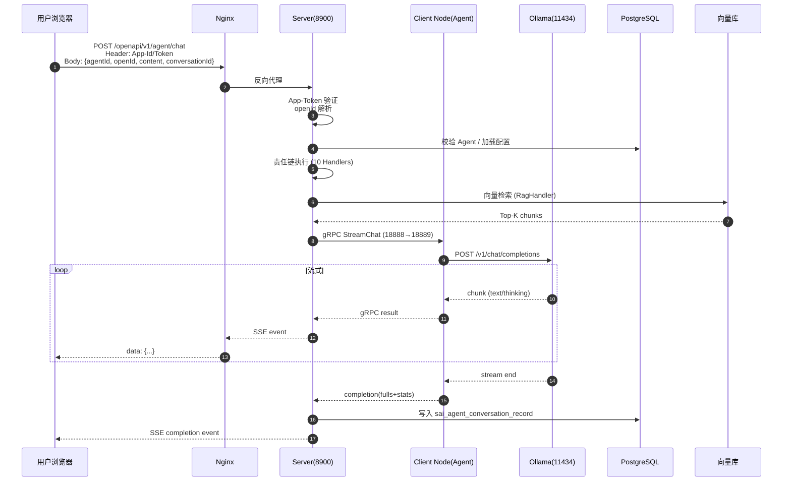
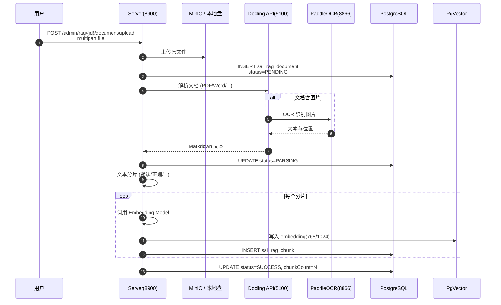
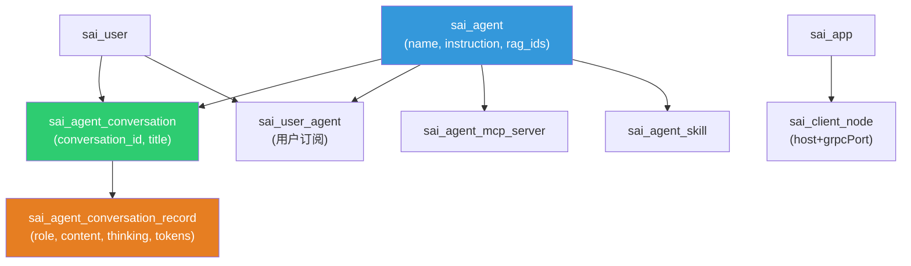

# API 接口与数据字典文档

> 适用范围：Snail AI Server（默认端口 8900）  
> 版本：v0.5.x  
> 配套源码：`snail-ai-server-openapi`、`snail-ai-server-admin`、`script/sql/snail_ai_schema.sql`

---

## 目录

1. [接口总览与鉴权](#1-接口总览与鉴权)
2. [OpenAPI 对外接口（用于第三方嵌入）](#2-openapi-对外接口)
3. [Admin 内部接口（后台管理）](#3-admin-内部接口)
4. [核心业务数据流](#4-核心业务数据流)
5. [关系型数据库设计](#5-关系型数据库设计)
6. [向量数据库设计](#6-向量数据库设计)
7. [附录：源码位置速查](#7-附录源码位置速查)

---

## 1. 接口总览与鉴权

### 1.1 接口分组

Snail AI 的 HTTP API 分为三大类：

| 类别 | Context Path | 鉴权方式 | 用途 |
|------|--------------|----------|------|
| **OpenAPI** | `/snail-ai/openapi/v1/*` | App-Token + embed-token（部分） | 第三方系统 / 前端嵌入调用 |
| **Admin** | `/snail-ai/admin/*` | JWT Bearer Token | 内部管理后台 |
| **资源回调** | `/snail-ai/resource/*` | JWT / OpenAPI 双栈 | 资源下载与预览 |

### 1.2 OpenAPI 鉴权方式

**方式一：HTTP Header 直接传 App 凭据**

| Header | 必填 | 说明 |
|--------|------|------|
| `Snail-Ai-App-Id` | 是 | 创建应用时生成的 AppID |
| `Snail-Ai-Token` | 是 | 创建应用时生成的 Token |
| `Snail-Ai-Embed-Token` | 否 | 由 `/embed-token` 签发的 JWT（用于前端嵌入式场景） |

> 部分只读场景可以**只携带 Embed-Token**，Server 会通过 HMAC256 验证 JWT 签名并解析出原始 App-Token。

**方式二：会话级 openId**

每个请求体都要带 `openId`（外部系统用户标识），用于：
- 创建/查找 OpenAPI 用户映射 (`sai_openapi_user`)；
- 隔离对话上下文与长期记忆；
- 鉴权不通过即拒绝调用。

### 1.3 通用响应结构

所有同步接口响应都使用 `Result<T>`：

```json
{
  "code": 200,
  "message": "success",
  "data": { ... },
  "traceId": "abc123def456"
}
```

| 字段 | 类型 | 说明 |
|------|------|------|
| `code` | int | 业务状态码，`200` 成功，其余失败 |
| `message` | string | 人类可读消息 |
| `data` | object | 业务数据，任意类型 |
| `traceId` | string | 服务端日志追踪 ID，便于排查 |

> 流式接口直接返回 NDJSON / SSE，不包装 `Result`。

---

## 2. OpenAPI 对外接口

> BaseURL：`http://<host>:8900/snail-ai/openapi/v1`  
> 所有接口路径常量定义：[`OpenApiPathConstants.java`](file:///d:/DevProjects/snail-ai/snail-ai-commons/snail-ai-commons-core/src/main/java/com/aizuda/snail/ai/common/constants/OpenApiPathConstants.java)

### 2.1 接口列表

| 接口路径 | 方法 | 功能描述 | 核心参数 | 响应结构 | 是否 SSE |
|----------|------|----------|----------|----------|----------|
| `/openapi/v1/agent/chat` | POST | **智能体流式对话**（SSE） | `agentId`、`openId`、`conversationId`、`content`、`attachments[]`、`disabledMcpServerIds`、`disabledSkillIds` | NDJSON：`thinking` / `text` / `completion` / `error` | ✅ 是 |
| `/openapi/v1/agent/chat/sync` | POST | 智能体同步对话（阻塞返回） | 同上 | `{fullText, fullThinking, tokens, durationMs}` | ❌ |
| `/openapi/v1/agents` | GET | 列出所有可见智能体 | `keyword`、`page`、`size` | `{records:[...], total}` | ❌ |
| `/openapi/v1/agent` | GET | 获取智能体详情（含预置问题） | `agentId` | `{id, name, instruction, presetQuestions, ...}` | ❌ |
| `/openapi/v1/user/agents` | GET | 当前 openId 已订阅的智能体 | `openId` | `[{agentId, ...}]` | ❌ |
| `/openapi/v1/user/agent` | POST | openId 订阅某个智能体 | `openId`、`agentId` | `{success:true}` | ❌ |
| `/openapi/v1/agent/conversations` | GET | 列出 openId 的对话历史 | `agentId`、`openId`、`page`、`size` | `{records:[], total}` | ❌ |
| `/openapi/v1/agent/conversations/messages` | GET | 获取某会话的消息记录 | `conversationId`、`openId` | `{records:[{role, content, thinking, ts}]}` | ❌ |
| `/openapi/v1/resource/upload` | POST | 上传图片等资源，返回 resourceId | `openId`、`originalName`、`fileSize`、`content(base64)`、`bizType` | `{id, accessUrl}` | ❌ |
| `/openapi/v1/embed-token` | POST | 签发 Embed-Token JWT | `openId`、`userId?` | `{token, expireAt}` | ❌ |
| `/openapi/v1/user/register` | POST | 注册外部用户映射 | `appId`、`openId`、`externalId?` | `{success:true}` | ❌ |
| `/openapi/v1/user` | GET | 查询外部用户信息 | `openId` | `{userId, openId, createDt}` | ❌ |

> **接口定义参考**：[`docs/api/openapi/chat.md`](file:///d:/DevProjects/snail-ai/docs/api/openapi/chat.md)

### 2.2 SSE 流式对话请求 / 响应格式

**请求示例：**

```bash
POST /snail-ai/openapi/v1/agent/chat
Content-Type: application/json
Snail-Ai-App-Id: snail-ai-agent-demo
Snail-Ai-Token: SAI_0d0f844da152475999ab1db2f8131210

{
  "agentId": 1,
  "openId": "dc43f1fc2da949d48f353cb61f14c1aa",
  "conversationId": "conv-2026-09-21-001",
  "content": "请用一句话介绍自己"
}
```

**响应（`text/event-stream`）：**

```
Content-Type: text/event-stream

data: {"type":"thinking","content":"用户希望我自我介绍..."}

data: {"type":"text","content":"我是"}

data: {"type":"text","content":"由通义实验室"}

data: {"type":"text","content":"开发的..."}

data: {"type":"completion","fullText":"我是由通义实验室开发的大型语言模型 Qwen。","fullThinking":"...","tokens":87,"durationMs":8320}
```

> 服务端实现：[`OpenApiChatController.java`](file:///d:/DevProjects/snail-ai/snail-ai-server/snail-ai-server-openapi/src/main/java/com/aizuda/snail/ai/openapi/controller/OpenApiChatController.java#L34-L38)

### 2.3 事件类型表

| `type` | 字段 | 说明 | 前端处理 |
|--------|------|------|----------|
| `thinking` | `content` | 模型推理/思考过程 | 显示在可折叠区域 |
| `text` | `content` | 正式回答片段 | 追加到正文区域 |
| `completion` | `fullText`、`fullThinking`、`tokens`、`durationMs` | 流结束统计 | 隐藏加载、关闭 SSE |
| `error` | `code`、`message` | 流式异常 | 错误提示 |

---

## 3. Admin 内部接口

> BaseURL：`http://<host>:8900/snail-ai/admin`  
> 鉴权：登录后获取 JWT，Header `Authorization: Bearer <token>`

### 3.1 接口列表

| 模块 | 路径前缀 | 功能 | 文档 |
|------|----------|------|------|
| **登录** | `/admin/auth/*` | 登录、登出、刷新 Token | — |
| **智能体** | `/admin/agent/*` | Agent CRUD、配置、上下线 | [`agent.md`](file:///d:/DevProjects/snail-ai/docs/api/admin/agent.md) |
| **模型** | `/admin/model/*` | 模型提供商与模型配置 | [`model.md`](file:///d:/DevProjects/snail-ai/docs/api/admin/model.md) |
| **知识库** | `/admin/rag/*` | RAG 知识库 CRUD、文档上传、检索测试 | [`rag.md`](file:///d:/DevProjects/snail-ai/docs/api/admin/rag.md) |
| **MCP 服务** | `/admin/mcp/*` | MCP 服务配置 | [`mcp.md`](file:///d:/DevProjects/snail-ai/docs/api/admin/mcp.md) |
| **技能** | `/admin/skill/*` | Skill 技能包管理 | [`skill.md`](file:///d:/DevProjects/snail-ai/docs/api/admin/skill.md) |
| **应用** | `/admin/app/*` | 客户端应用注册、Token 生成 | [`app.md`](file:///d:/DevProjects/snail-ai/docs/api/admin/app.md) |
| **资源** | `/admin/resource/*` | 上传图片、文件、附件 | [`resource.md`](file:///d:/DevProjects/snail-ai/docs/api/admin/resource.md) |
| **用户** | `/admin/user/*` | 用户管理、登录、权限 | [`user.md`](file:///d:/DevProjects/snail-ai/docs/api/admin/user.md) |

### 3.2 典型接口示例：智能体对话

> 部分场景下 Admin 端也提供同步接口（无 SSE），用于调试 / 测试。

| 方法 | 路径 | 功能 | 备注 |
|------|------|------|------|
| GET | `/admin/agent/page` | 分页查询智能体 | 支持按 `status`、`isFeatured` 等筛选 |
| POST | `/admin/agent` | 新建智能体 | body: `{name, instruction, chatModelId, ...}` |
| PUT | `/admin/agent/{id}` | 更新智能体 | 含 `ragIds`、`ragCallMode`、`mcpEnabled` 等 |
| DELETE | `/admin/agent/{id}` | 删除智能体（软删） | 需校验未绑定的会话 |
| POST | `/admin/agent/{id}/publish` | 上线 / 下线 | `{status:1\|2\|3\|4}` |
| POST | `/admin/agent/{id}/clone` | 克隆智能体 | 复制配置 + 绑定关系 |
| GET | `/admin/agent/{id}/preset-questions` | 拉取预置问题 | 供前端展示 |
| GET | `/admin/agent/{id}/context-preview` | 调试上下文组装结果 | `{messages, estimatedTokens, compressionApplied}` |

> **细节参考**：[`docs/api/admin/agent.md`](file:///d:/DevProjects/snail-ai/docs/api/admin/agent.md)

---

## 4. 核心业务数据流

### 4.1 流式对话（SSE）数据流



### 4.2 知识库文档入库数据流



### 4.3 对话数据存储结构



---

## 5. 关系型数据库设计

> 完整脚本：[`script/sql/snail_ai_schema.sql`](file:///d:/DevProjects/snail-ai/script/sql/snail_ai_schema.sql)  
> 通用字段：`id`（BIGINT 自增主键）、`create_dt`、`update_dt`（DATETIME）。

### 5.1 模块分组与表清单

| 模块 | 表 |
|------|----|
| **用户** | `sai_user`、`sai_openapi_user` |
| **模型** | `sai_model_provider`、`sai_model_config`、`sai_model_usage_stat` |
| **智能体** | `sai_agent`、`sai_agent_conversation`、`sai_agent_conversation_record`、`sai_agent_usage_stat`、`sai_user_agent` |
| **RAG** | `sai_rag`、`sai_rag_document`、`sai_rag_document_image`、`sai_rag_chunk` |
| **MCP** | `sai_mcp_server`、`sai_agent_mcp_server` |
| **Skill** | `sai_skill`、`sai_skill_file`、`sai_agent_skill` |
| **应用/节点** | `sai_app`、`sai_client_node` |
| **存储/资源** | `sai_store_instance`、`sai_resource` |

### 5.2 核心表结构（取自 `snail_ai_schema.sql`）

#### 5.2.1 用户与鉴权

**`sai_user`** — 平台用户表

| 字段 | 类型 | 注释 |
|------|------|------|
| `id` | BIGINT AUTO_INCREMENT PK | 主键 |
| `role` | INT | 角色：1=普通 2=管理员 |
| `totals` | INT | 累计消耗 Token / 总额 |
| `username` | VARCHAR(255) UNIQUE | 登录名 |
| `nickname` | VARCHAR(128) | 用户昵称 |
| `email` | VARCHAR(64) | 邮箱 |
| `password` | VARCHAR(255) NOT NULL | PBKDF2 加密 |
| `resource_id` | BIGINT | 关联 `sai_resource.id`（头像） |

**`sai_openapi_user`** — 外部用户映射表

| 字段 | 类型 | 注释 |
|------|------|------|
| `id` | BIGINT PK | |
| `app_id` | VARCHAR(128) | 关联 `sai_app.app_id` |
| `open_id` | VARCHAR(64) | 外部系统唯一标识 |
| `platform_user_id` | BIGINT | 关联 `sai_user.id`，自动注册时创建 |
| `external_id` | VARCHAR(256) | 外部业务用户 ID（幂等） |
| UNIQUE KEY | `(app_id, open_id)` `(app_id, external_id)` | 防重 |

#### 5.2.2 模型管理

**`sai_model_provider`** — 模型提供商

| 字段 | 类型 | 注释 |
|------|------|------|
| `provider_name` | VARCHAR(255) UNIQUE | 人类可读名 |
| `provider_key` | VARCHAR(50) UNIQUE | 程序标识符（openai/ollama/...） |
| `is_enabled` | TINYINT(1) | 是否启用 |

**`sai_model_config`** — 模型实例配置

| 字段 | 类型 | 注释 |
|------|------|------|
| `provider_id` | BIGINT FK → `sai_model_provider.id` | |
| `model_name` | VARCHAR(255) | 人类可读名 |
| `model_key` | VARCHAR(100) | 实际模型标识（如 `qwen3:8b`） |
| `model_type` | VARCHAR(50) | `CHAT`/`EMBEDDING`/`RERANKER`/`IMAGE`/`SPEECH` |
| `adapter_key` | VARCHAR(100) | 协议适配器（`openai-compatible`/`http`...） |
| `api_key` | VARCHAR(1000) | 加密存储 |
| `api_endpoint` | VARCHAR(500) | API 端点 |
| `config_json` | TEXT | 模型参数（temperature、max_tokens...） |
| `scope` | VARCHAR(20) | `GLOBAL`/`PERSONAL` |
| `is_default` | TINYINT(1) | 是否该类型默认模型 |

#### 5.2.3 智能体与对话

**`sai_agent`** — 智能体主表（核心）

| 字段 | 类型 | 注释 |
|------|------|------|
| `name` | VARCHAR(255) | 智能体名称 |
| `description` | TEXT | |
| `instruction` | TEXT | System Prompt |
| `greeting` | TEXT | 欢迎语 |
| `preset_questions` | TEXT | 预设问题 JSON 数组 |
| `chat_model_id` | BIGINT FK | 对话模型 |
| `memory_enabled` | TINYINT(1) | 启用长期记忆 |
| `mcp_enabled` | TINYINT(1) | 启用 MCP |
| `skill_enabled` | TINYINT(1) | 启用 Skill |
| `web_search_enabled` | TINYINT(1) | 启用联网搜索 |
| `rag_enabled` | TINYINT(1) | 启用 RAG |
| `rag_ids` | VARCHAR(64) | 绑定的 RAG ID 列表（逗号分隔，最多 5 个） |
| `rag_call_mode` | TINYINT | `1`=智能调用 `2`=强制调用 |
| `short_term_memory_size` | INT DEFAULT 20 | 滑动窗口保留条数 |
| `creator_id` | BIGINT | 创建者 |
| `is_featured` | TINYINT(1) | 是否精选 |
| `view_count` | INT | 浏览次数 |
| `status` | TINYINT | 1=活跃 2=非活跃 3=废弃 4=禁用 |
| `app_id` | VARCHAR(128) | 关联应用（NULL=本地执行） |

**`sai_agent_conversation`** — 对话

| 字段 | 类型 | 注释 |
|------|------|------|
| `agent_id` | BIGINT FK | |
| `user_id` | BIGINT FK | |
| `conversation_id` | VARCHAR(64) UNIQUE | UUID |
| `title` | VARCHAR(255) | 自动摘要标题 |

**`sai_agent_conversation_record`** — 消息记录

| 字段 | 类型 | 注释 |
|------|------|------|
| `agent_id` | BIGINT | |
| `conversation_id` | VARCHAR(64) FK | |
| `user_id` | BIGINT | |
| `role` | VARCHAR(16) | `user` / `assistant` |
| `content` | TEXT | 消息正文 |
| `thinking` | TEXT | 思考过程（仅 assistant） |
| `metadata` | LONGTEXT | 扩展元数据 JSON |
| `status` | INT | 1=成功 2=失败 3=进行中 |
| `input_tokens` | INT | prompt Token 数 |
| `output_tokens` | INT | completion Token 数 |
| `cache_tokens` | INT | 缓存命中 Token 数 |

#### 5.2.4 RAG 知识库

**`sai_rag`** — 知识库主表

| 字段 | 类型 | 注释 |
|------|------|------|
| `name` | VARCHAR(255) | |
| `embedding_model_id` | BIGINT | 嵌入模型 |
| `dimension_of_vector_model` | INT | 向量维度（必须与嵌入模型一致） |
| `rerank_model_id` | BIGINT | 可选 Reranker |
| `vector_store_instance_id` | BIGINT | 向量库实例 |
| `search_engine_instance_id` | BIGINT | 全文检索实例 |
| `search_engine_enable` | TINYINT(1) | 是否启用混合检索 |
| `delimiter` | VARCHAR(32) | 分隔符 |
| `rag_enhancement` | TEXT | 知识增强内容 |
| `config` | TEXT | 检索/问答的配置参数 JSON |
| `dedup_strategy` | TINYINT | 0=NONE 1=BY_NAME 2=BY_CONTENT 3=BY_NAME_OR_CONTENT |
| `dedup_action` | TINYINT | 0=REJECT 1=SKIP 2=OVERWRITE |
| `upload_confirm` | TINYINT(1) | 二次确认 |

**`sai_rag_document`** — 文档

| 字段 | 类型 | 注释 |
|------|------|------|
| `rag_id` | BIGINT FK | |
| `name` | VARCHAR(255) | 文件名 |
| `file_type` | VARCHAR(32) | pdf/docx/... |
| `source_type` | VARCHAR(32) | UPLOAD/NOTE/... |
| `content` | TEXT | 提取文本 |
| `status` | TINYINT | 0=PENDING 1=PARSING 2=PROCESSING 3=SUCCESS 4=FAILED |
| `error_msg` | TEXT | |
| `content_hash` | VARCHAR(64) | SHA-256 用于去重 |
| `resource_id` | BIGINT | 资源库关联 |
| `page_count`/`element_count`/`table_count`/`image_count` | INT | Docling 解析指标 |
| `parse_time` | INT | 解析耗时 ms |

**`sai_rag_chunk`** — 分片

| 字段 | 类型 | 注释 |
|------|------|------|
| `rag_id` | BIGINT FK | |
| `document_id` | BIGINT FK | |
| `paragraph_index` | INT | 段落序号 |
| `chunk_index` | INT | 分片序号 |
| `content` | TEXT | 文本 |
| `token_count` | INT | Token 数 |
| `vector_id` | VARCHAR(128) | 向量库中的 ID |
| `content_hash` | VARCHAR(64) | chunk 内容哈希（去重） |
| `source_type` | VARCHAR(20) | TEXT / IMAGE |

#### 5.2.5 应用与节点

**`sai_app`** — 客户端应用

| 字段 | 类型 | 注释 |
|------|------|------|
| `app_id` | VARCHAR(128) UNIQUE | 应用唯一标识 |
| `app_name` | VARCHAR(255) | |
| `token` | VARCHAR(128) | 通信凭据（创建时生成） |
| `route_strategy` | VARCHAR(32) | LEAST_LOAD / ROUND_ROBIN / WEIGHTED / STICKY |
| `status` | TINYINT(1) | 1=启用 0=停用 |

**`sai_client_node`** — Agent 客户端节点

| 字段 | 类型 | 注释 |
|------|------|------|
| `app_id` | VARCHAR(128) FK | |
| `host_id` | VARCHAR(128) | 实例唯一 ID |
| `host_ip` | VARCHAR(64) | 客户端 IP |
| `grpc_port` | INT | gRPC 端口 |
| `max_concurrent` | INT | 最大并发对话 |
| `active_chats` | INT | 当前活跃数 |
| `supported_providers` | TEXT | 支持的提供商 JSON |
| `labels` | TEXT | 路由标签 |
| `expire_dt` | DATETIME | 心跳过期时间 |
| UNIQUE KEY | `(app_id, host_id)` | |

#### 5.2.6 存储与资源

**`sai_store_instance`** — 存储实例（向量库 / 全文引擎）

| 字段 | 类型 | 注释 |
|------|------|------|
| `name` | VARCHAR(128) | |
| `category` | TINYINT | 1=向量库 2=搜索引擎 |
| `type` | TINYINT | 1=PG_VECTOR 2=MILVUS 3=ELASTICSEARCH 4=PG_FULLTEXT |
| `config` | TEXT | 连接参数 JSON |
| `is_default` | TINYINT(1) | 该分类下默认实例 |

**`sai_resource`** — 通用资源

| 字段 | 类型 | 注释 |
|------|------|------|
| `storage_key` | VARCHAR(512) UNIQUE | |
| `original_name` | VARCHAR(255) | |
| `file_size` | BIGINT | |
| `mime_type` | VARCHAR(128) | |
| `storage_type` | VARCHAR(32) | LOCAL / MINIO |
| `access_url` | VARCHAR(1024) | |
| `biz_type` | VARCHAR(64) | AVATAR / ATTACHMENT / DOCUMENT / GENERAL |
| `biz_id` | BIGINT | 关联业务 ID |
| `creator_id` | BIGINT | 上传者 |

---

## 6. 向量数据库设计

> Snail AI 支持 **4 种向量/全文后端**，由 `sai_store_instance.type` 字段标识。

### 6.1 后端类型

| type 枚举 | 名称 | 类别 | 适用场景 |
|-----------|------|------|----------|
| `1` | **PG_VECTOR** | 向量库 | 中小规模，一体化部署 |
| `2` | **MILVUS** | 向量库 | 大规模，分布式扩展 |
| `3` | **ELASTICSEARCH** | 既是向量又是全文 | 混合检索 |
| `4` | **PG_FULLTEXT** | 全文引擎 | 轻量 BM25 |

### 6.2 Collection / 表结构

不同后端的"集合"概念不同，对照表如下：

| 后端 | 集合名 | Schema 所在位置 |
|------|--------|-----------------|
| **PgVector** | `sai_rag_chunk` 表 + `vector(dim)` 列 | 数据库内（PG） |
| **Milvus** | `snail_rag_{ragId}` (动态创建) | Milvus 内部 |
| **Elasticsearch** | `snail-rag-{ragId}` 索引 | ES 集群 |
| **PG 全文** | `sai_rag_chunk` 表 + `tsvector` 列 | 数据库内（PG） |

> 实际创建由 `RagIngestionService` 完成，调用 Spring AI / Milvus SDK 自动建表。

### 6.3 向量元数据（Metadata）

每个向量记录都带关联元数据，用于召回时过滤和回显：

| 字段 | 类型 | 说明 |
|------|------|------|
| `ragId` | bigint | 所属知识库 ID |
| `documentId` | bigint | 所属文档 ID |
| `chunkId` | bigint | 所属分片 ID |
| `documentName` | string | 文档名（用于回显） |
| `paragraphIndex` | int | 段落序号 |
| `chunkIndex` | int | 分片序号 |
| `tokenCount` | int | 分片 Token 数 |
| `sourceType` | string | TEXT / IMAGE |
| `imageUrl` | string | 若 sourceType=IMAGE 时填 |
| `vectorId` | string | 向量库内部 ID（`sai_rag_chunk.vector_id`） |

### 6.4 向量维度约束

> **关键约束**：`sai_rag.dimension_of_vector_model` 必须与 embedding 模型维度完全一致，否则写入报错。

| Embedding 模型 | 维度 |
|----------------|------|
| `nomic-embed-text` | **768** |
| `bge-m3` | **1024** |
| `text-embedding-3-small` (OpenAI) | **1536** |
| `text-embedding-3-large` (OpenAI) | **3072** |
| `text-embedding-v2` (Zhipu) | **1024** |

> 修改嵌入模型必须先重建知识库（删除旧 chunks 再重新向量化），详见 [`03-搭建与部署指南.md`](file:///d:/DevProjects/snail-ai/docs/03-搭建与部署指南.md) 的"向量维度不匹配"章节。

### 6.5 索引算法（推荐配置）

| 后端 | 索引 | 适用规模 | 配置示例 |
|------|------|----------|----------|
| PgVector | IVFFlat | < 1亿 | `CREATE INDEX ... USING ivfflat (embedding vector_cosine_ops) WITH (lists = 100);` |
| PgVector | HNSW | < 1亿，召回更精准 | `CREATE INDEX ... USING hnsw (embedding vector_cosine_ops) WITH (m = 16, ef_construction = 64);` |
| Milvus | HNSW | 1亿+ | `index_type=HNSW, metric_type=COSINE, params={M:16, efConstruction:64}` |
| ES | HNSW | 1亿以下 | `"type":"hnsw","space_type":"cosinesimil","m":16,"ef_construction":100` |

### 6.6 完整存储配置 JSON 示例

```json
{
  "name": "默认 PgVector",
  "category": 1,
  "type": 1,
  "config": {
    "url": "jdbc:postgresql://localhost:5432/snail_ai",
    "username": "postgres",
    "password": "encrypted:...",
    "schema": "public",
    "pool": {
      "maxActive": 20,
      "maxIdle": 5,
      "minIdle": 2,
      "maxWait": 10000
    }
  },
  "isDefault": true
}
```

---

## 7. 附录：源码位置速查

| 类别 | 文件 |
|------|------|
| OpenAPI 路径常量 | [OpenApiPathConstants.java](file:///d:/DevProjects/snail-ai/snail-ai-commons/snail-ai-commons-core/src/main/java/com/aizuda/snail/ai/common/constants/OpenApiPathConstants.java) |
| OpenAPI Chat Controller | [OpenApiChatController.java](file:///d:/DevProjects/snail-ai/snail-ai-server/snail-ai-server-openapi/src/main/java/com/aizuda/snail/ai/openapi/controller/OpenApiChatController.java) |
| OpenAPI Chat 文档 | [chat.md](file:///d:/DevProjects/snail-ai/docs/api/openapi/chat.md) |
| Admin Agent API | [agent.md](file:///d:/DevProjects/snail-ai/docs/api/admin/agent.md) |
| Admin App API | [app.md](file:///d:/DevProjects/snail-ai/docs/api/admin/app.md) |
| Admin MCP API | [mcp.md](file:///d:/DevProjects/snail-ai/docs/api/admin/mcp.md) |
| Admin Model API | [model.md](file:///d:/DevProjects/snail-ai/docs/api/admin/model.md) |
| Admin RAG API | [rag.md](file:///d:/DevProjects/snail-ai/docs/api/admin/rag.md) |
| Admin Skill API | [skill.md](file:///d:/DevProjects/snail-ai/docs/api/admin/skill.md) |
| Admin Resource API | [resource.md](file:///d:/DevProjects/snail-ai/docs/api/admin/resource.md) |
| Admin User API | [user.md](file:///d:/DevProjects/snail-ai/docs/api/admin/user.md) |
| SQL 脚本 | [snail_ai_schema.sql](file:///d:/DevProjects/snail-ai/script/sql/snail_ai_schema.sql) |
| ER 数据模型 | [data-model.md](file:///d:/DevProjects/snail-ai/docs/architecture/data-model.md) |
| RAG 流水线 | [rag-pipeline.md](file:///d:/DevProjects/snail-ai/docs/architecture/rag-pipeline.md) |
| 记忆架构 | [memory-architecture.md](file:///d:/DevProjects/snail-ai/docs/architecture/memory-architecture.md) |
| 技术架构总览 | [01-技术架构设计.md](file:///d:/DevProjects/snail-ai/docs/01-技术架构设计.md) |
| 启动与验证 | [02-启动验证与功能说明.md](file:///d:/DevProjects/snail-ai/docs/02-启动验证与功能说明.md) |
| 部署指南 | [03-搭建与部署指南.md](file:///d:/DevProjects/snail-ai/docs/03-搭建与部署指南.md) |
| AI 核心链路 | [04-AI核心链路与Prompt设计.md](file:///d:/DevProjects/snail-ai/docs/04-AI核心链路与Prompt设计.md) |

---

> **快速跳转**：
> - 想调用 AI 对话？看 [§2.2 SSE 请求 / 响应](#22-sse-流式对话请求--响应格式)
> - 想设计数据库？看 [§5.2 核心表结构](#52-核心表结构取自-snail_ai_schemasql)
> - 想排查向量库？看 [§6.4 向量维度约束](#64-向量维度约束)
