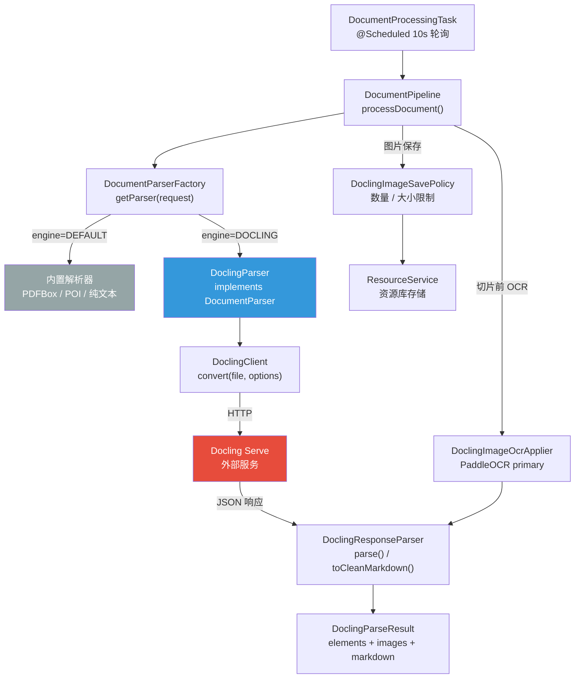
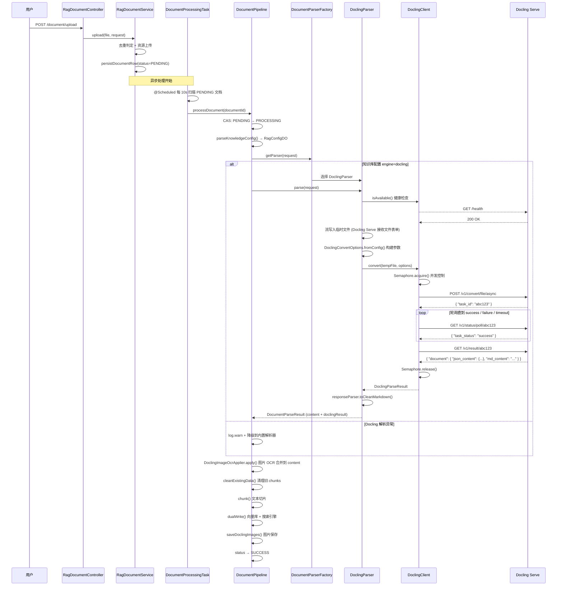
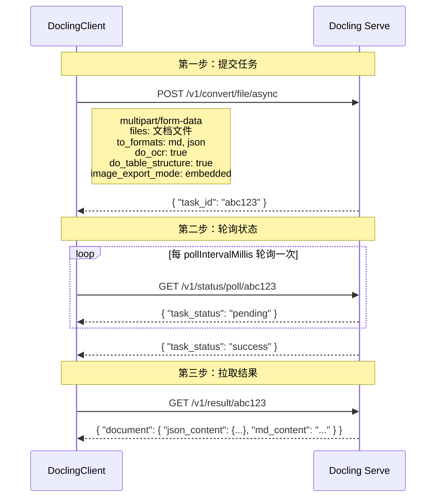
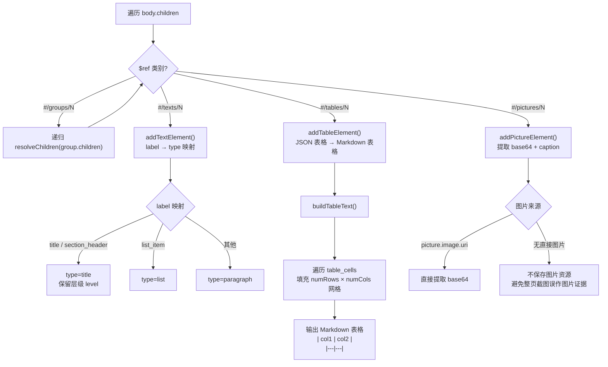
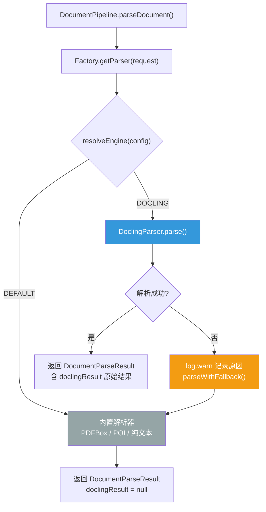
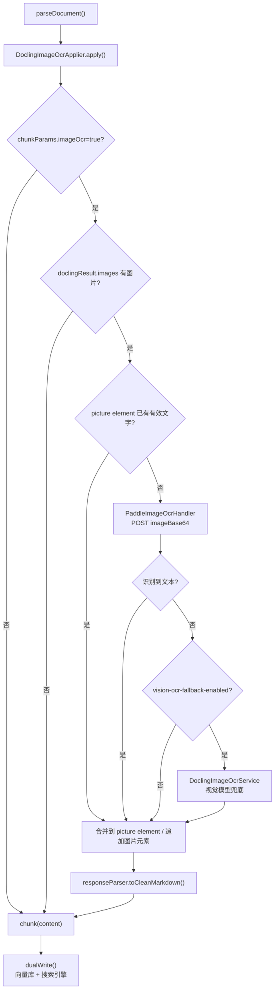
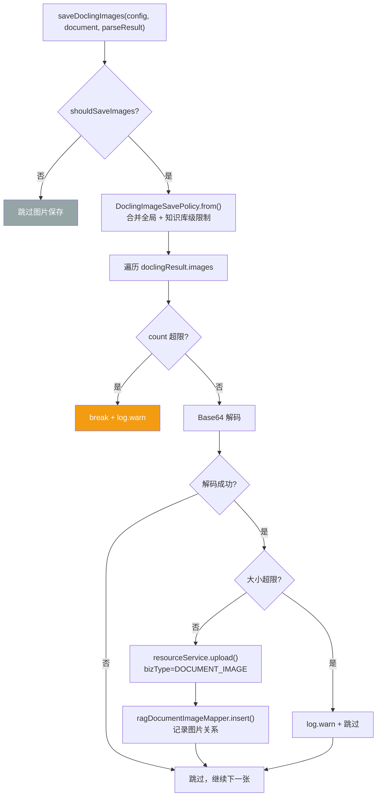
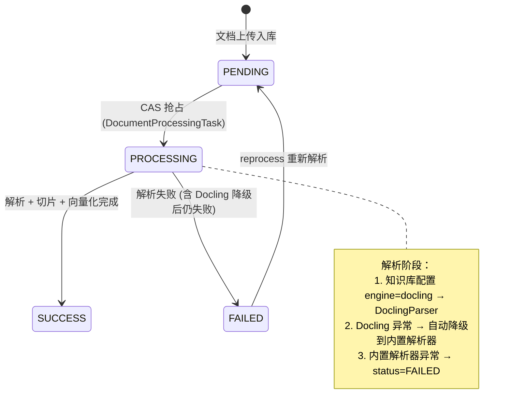

# Docling 解析引擎

## 概述

Docling 是 Snail AI 的**可选增强解析引擎**，通过 HTTP 调用外部 [Docling Serve](https://github.com/DS4SD/docling) 服务，在项目内置解析器（PDFBox / POI / 纯文本）之上提供更强大的文档结构化解析能力，包括：

- 高精度 PDF 文本提取与布局识别
- 表格结构识别与 Markdown 表格输出
- 图片提取与 OCR 文本识别
- 文档元数据（页数、元素类型、阅读顺序）

Docling 是**增强能力而非必要条件**——当 Docling Serve 不可用或解析失败时，系统会自动降级回内置解析器，不影响知识库导入流程。

## 架构设计

### 模块分布

```
snail-ai-feature-rag/src/main/java/.../features/rag/
├── docling/                              ← Docling HTTP 客户端 + 响应解析
│   ├── DoclingClient.java                核心 HTTP 客户端（submit → poll → fetch）
│   ├── DoclingProperties.java            @ConfigurationProperties 应用级配置
│   ├── DoclingConvertOptions.java        转换参数（OCR / 表格 / 图片 / PDF 后端）
│   ├── DoclingParseResult.java           解析结果 DTO（elements + images + metadata）
│   ├── DoclingResponseParser.java        JSON 响应解析，重建 Markdown
│   ├── DoclingMarkdownSanitizer.java     清理 base64 内嵌图片和多余空行
│   └── DoclingException.java            异常类
├── pipeline/
│   ├── DocumentPipeline.java             文档处理流水线（总调度，含降级保护）
│   ├── DoclingImageOcrApplier.java       图片 OCR 文本合并（切片前执行）
│   ├── PaddleImageOcrHandler.java        PaddleOCR HTTP 调用
│   ├── DoclingImageOcrService.java       视觉模型 OCR 兜底（可选）
│   └── DoclingImageSavePolicy.java       图片保存策略（数量 / 大小限制）
├── strategy/parser/
│   ├── DoclingParser.java                DocumentParser 策略实现
│   ├── DocumentParserFactory.java        解析器工厂（按引擎 + 文件类型选择）
│   ├── DocumentParseResult.java          解析结果 DTO（含 Docling 原始结果引用）
│   └── DocumentParser.java               解析器策略接口
└── enums/
    └── DocumentParseEngineEnum.java      DEFAULT / DOCLING 枚举
```

### 类关系图



## 完整调用链

从文档上传到 Docling 解析完成的端到端时序：



## 异步三步协议

Docling Serve 采用异步处理模型，大文件解析可能耗时较长。客户端通过三步协议完成一次解析：



### 接口说明

| 步骤 | 方法 | 路径 | 说明 |
|------|------|------|------|
| 提交 | `POST` | `/v1/convert/file/async` | 上传文件 + 转换参数，返回 `task_id` |
| 轮询 | `GET` | `/v1/status/poll/{task_id}` | 查询任务状态，返回 `task_status` |
| 拉取 | `GET` | `/v1/result/{task_id}` | 获取解析结果 JSON |

### 双格式请求

每次解析同时请求 Markdown 和 JSON 两种格式：

| 格式 | 用途 |
|------|------|
| `md` | 清理 base64 图片后直接用于切片和向量化 |
| `json` | 提取页数、表格、图片、元数据等结构化统计信息 |

## JSON 响应解析机制

### $ref 引用展开

Docling Serve 的 JSON 响应使用 `$ref` 机制分离数据结构与内容，在 `body.children` 中按文档阅读顺序排列引用：

```json
{
  "document": {
    "json_content": {
      "body": {
        "children": [
          { "$ref": "#/texts/0" },
          { "$ref": "#/pictures/0" },
          { "$ref": "#/groups/0" },
          { "$ref": "#/tables/0" }
        ]
      },
      "texts": [
        { "text": "第一章 概述", "label": "title", "level": 1, "prov": [{"page_no": 1}] }
      ],
      "pictures": [
        { "image": {"uri": "data:image/png;base64,..."}, "captions": [{"text": "图1"}] }
      ],
      "groups": [
        { "children": [
          { "$ref": "#/texts/1" },
          { "$ref": "#/texts/2" }
        ]}
      ],
      "tables": [
        { "data": { "table_cells": [...], "num_cols": 3, "num_rows": 2 } }
      ]
    },
    "md_content": "# 第一章 概述\n\n..."
  }
}
```

`DoclingResponseParser.resolveChildren()` 的解析流程：



> 注意：`pages[page].image` 是整页图，不再作为 `picture` 的图片证据保存。否则问答和检索会把整页截图当成命中图片，出现低清晰度、位置不准确的问题。没有 `picture.image.uri` 的图片元素仍会保留图注/OCR 文本进入分片，但不会生成图片资源。

### 标签类型映射

| Docling label | 映射类型 | 说明 |
|---------------|----------|------|
| `title` | `title` | 文档标题，保留层级 |
| `section_header` | `title` | 章节标题，保留层级 |
| `list_item` | `list` | 列表项 |
| 其他（text / caption 等） | `paragraph` | 普通段落 |

## Markdown 重建策略

`DoclingResponseParser.toCleanMarkdown()` 从结构化元素重建干净的 Markdown，最终通过 `DoclingMarkdownSanitizer` 清理残留内容。

### 元素到 Markdown 的转换规则

| 元素类型 | 输出格式 | 示例 |
|---------|----------|------|
| `title` | `#` × level + 文本 | `## 第一章`（level=2） |
| `paragraph` | 纯文本 + 双换行 | `这是段落内容\n\n` |
| `table` | 已在解析时转为 Markdown 表格 | `\| a \| b \|\n\|-\|-\|\n\| 1 \| 2 \|` |
| `picture` | 跳过（不进 chunk 文本） | 图片由 DocumentPipeline 统一保存 |
| `list` | 纯文本 | 列表项原文 |

### Markdown 清理

| 清理项 | 正则 | 替换为 |
|--------|------|--------|
| base64 内嵌图片 | `!\[[^]]*]\(data:image/[^)]+\)` | `[image]` |
| 连续 3+ 空行 | `\n{3,}` | `\n\n` |

## 降级保护设计

Docling 是增强能力，**绝不阻断主流程**。当 Docling Serve 不可用或解析失败时，系统自动降级回内置解析器：



降级触发条件：
- Docling Serve 健康检查失败（`/health` 非 200）
- Docling Serve 未启用（`snail-ai.rag.docling.enabled=false`）
- 异步任务返回 `failure` 状态
- 轮询超时
- 响应解析失败
- 任何网络异常

降级时仅记录 `warn` 级别日志，不影响文档处理流水线的整体状态流转。

## 并发控制

通过本地 `Semaphore` 限制单应用实例同时提交给 Docling Serve 的任务数：

```java
// 初始化，默认 concurrency=3
parseSemaphore = new Semaphore(Math.max(1, properties.getConcurrency()));

// 每次 convert() 调用
parseSemaphore.acquire();  // 获取许可
try {
    // submit → poll → fetch
} finally {
    parseSemaphore.release();  // 释放许可
}
```

## 图片 OCR 流程

Docling 负责抽取文档中的图片和结构化元素。图片中的文字识别由 `DoclingImageOcrApplier` 在切片、向量化、全文搜索写入之前完成：



当前 Starter 配置默认允许调用本地 PaddleOCR，但仍需要在知识库配置中开启 `chunkParams.imageOcr` 才会执行图片 OCR。流程会先复用 Docling 已抽取出的图片文字；只有 Docling 图片没有有效文字时才调用 PaddleOCR。`vision-ocr-fallback-enabled` 仅用于确实需要视觉模型兜底的场景，默认关闭以避免配额耗尽。

## 图片保存流程

Docling 从文档中提取的图片，由 `DocumentPipeline.saveDoclingImages()` 统一保存到资源库：



### 图片保存限制

| 限制项 | 全局默认值 | 知识库级覆盖 | 说明 |
|--------|-----------|-------------|------|
| `maxImageCount` | 100 | `parseParams.docling.maxImageCount` | 单文档最多保存图片数 |
| `maxImageBytes` | 10 MB | `parseParams.docling.maxImageBytes` | 单张图片最大字节数 |

### 图片清理

文档删除或覆盖上传（OVERWRITE）时，同步清理关联的图片资源：

1. 查询 `sai_rag_document_image` 中该文档的所有图片记录
2. 逐个调用 `resourceService.delete(resourceId)` 删除资源库文件
3. 删除 `sai_rag_document_image` 表中的关联行

## 配置体系

### 应用级配置

```yaml
snail-ai:
  rag:
    docling:
      enabled: true                 # 是否启用 Docling（默认 false）
      url: "http://127.0.0.1:5001" # Docling Serve 地址
      timeout-seconds: 300          # 单个任务整体超时（秒）
      concurrency: 3               # 最大并发任务数
      health-timeout-millis: 3000  # 健康检查超时（毫秒）
      poll-interval-millis: 3000   # 状态轮询间隔（毫秒）
      status-timeout-millis: 10000 # 状态查询 HTTP 超时（毫秒）
      result-timeout-millis: 30000 # 结果拉取 HTTP 超时（毫秒）
      max-image-count: 100         # 全局最大图片保存数
      max-image-bytes: 10485760    # 全局单张最大图片字节数（10MB）
      paddle-ocr-enabled: true     # 是否启用本地 PaddleOCR 图片识别
      paddle-ocr-url: "http://127.0.0.1:8866/ocr" # PaddleOCR HTTP 地址
      paddle-ocr-timeout-millis: 180000 # PaddleOCR HTTP 超时（毫秒）
      vision-ocr-fallback-enabled: false # PaddleOCR 无结果时是否启用视觉模型兜底
```

### 知识库级配置

在知识库的 `config` JSON 中配置 `parseParams`：

```json
{
  "chunkParams": {
    "imageOcr": true
  },
  "parseParams": {
    "engine": "docling",
    "docling": {
      "doOcr": true,
      "doTableStructure": true,
      "imageExportMode": "embedded",
      "ocrLang": ["en", "zh"],
      "pdfBackend": "dlparse_v4",
      "saveImages": true,
      "maxImageCount": 50,
      "maxImageBytes": 5242880
    }
  }
}
```

### 配置项说明

| 参数 | 类型 | 默认值 | 说明 |
|------|------|--------|------|
| `engine` | string | `default` | 解析引擎：`default` 内置解析器，`docling` 外部 Docling Serve |
| `doOcr` | boolean | `true` | 是否启用 OCR，适用于扫描件或图片型 PDF |
| `doTableStructure` | boolean | `true` | 是否启用表格结构识别 |
| `imageExportMode` | string | `embedded` | 图片导出模式 |
| `ocrLang` | string[] | `["en"]` | OCR 语言列表，如 `["en", "zh"]` |
| `pdfBackend` | string | `dlparse_v4` | PDF 解析后端，随 Docling Serve 版本调整 |
| `saveImages` | boolean | `true` | 是否将 Docling 提取的图片保存到资源库 |
| `maxImageCount` | int | 100（全局配置） | 单文档最多保存的图片数 |
| `maxImageBytes` | long | 10MB（全局配置） | 单张图片最大字节数 |

### 配置优先级

```
知识库级 DoclingParams  >  应用级 DoclingProperties  >  代码默认值
```

- `engine` 决定使用哪个解析引擎
- `DoclingConvertOptions.fromConfig()` 将知识库配置映射为 HTTP 请求参数
- `DoclingImageSavePolicy.from()` 合并全局与知识库级图片限制

## 数据库影响

### sai_rag_document 新增字段

| 字段 | 类型 | 说明 |
|------|------|------|
| `page_count` | int | Docling 解析的文档页数 |
| `element_count` | int | 结构化元素总数（标题 + 段落 + 表格 + 图片） |
| `table_count` | int | 表格元素数量 |
| `image_count` | int | 图片元素数量 |
| `parse_time` | int | 解析耗时（毫秒） |
| `md_content` | text | Docling 清理后的 Markdown 内容 |
| `doc_metadata` | text | Docling 文档元数据 JSON |

### sai_rag_document_image 表

新增表，存储 Docling 提取的图片与资源库的映射关系：

| 字段 | 类型 | 说明 |
|------|------|------|
| `id` | bigint | 主键 |
| `rag_id` | bigint | 所属知识库 ID |
| `document_id` | bigint | 所属文档 ID |
| `resource_id` | bigint | 资源库中的图片资源 ID |
| `chunk_id` | bigint | 图片 OCR/图注关联到的切片 ID |
| `image_index` | int | 图片在文档中的保存序号 |
| `image_url` | varchar | 图片访问地址 |
| `caption` | varchar | Docling 解析出的图注 |
| `figure_no` | varchar | 从图注拆出的图号，如 `图 5` |
| `figure_title` | varchar | 从图注拆出的图标题 |
| `section_title` | varchar | 图片所属最近章节标题 |
| `source_page` | int | 图片所在原文页码 |
| `document_name` | varchar | 图片所属文件名快照 |
| `ocr_text` | text | 图片 OCR 文本 |
| `create_dt` | datetime | 创建时间 |
| `update_dt` | datetime | 更新时间 |

检索最终阶段会按 `chunk_id` 批量回填图片证据到 `SearchResult.images`，问答流结束事件会返回同一批引用，前端可据此展示命中图片、页码、章节和文件名。

## 文档处理状态流转



## 支持的文件类型

Docling 当前支持以下文件格式：

| 格式 | 扩展名 | 说明 |
|------|--------|------|
| PDF | `.pdf` | 支持文本提取、OCR、表格识别 |
| Word | `.docx` | Microsoft Word 文档 |
| Excel | `.xlsx` `.xls` | 表格结构识别 |
| PowerPoint | `.pptx` | 幻灯片文本提取 |
| HTML | `.html` | 网页文档 |
| Markdown | `.md` | 轻量级标记语言 |

> **注意：** DoclingParser 仅当 `snail-ai.rag.docling.enabled=true` 且知识库配置 `parseParams.engine=docling` 时才生效。不支持的格式（如 `.txt`、`.csv`）始终使用内置解析器。
