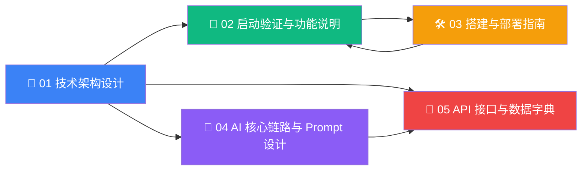

# 📚 Snail AI 项目交付文档中心

> **文档版本**：v0.5.x  
> **更新日期**：2026-09-21  
> **适用范围**：项目交付、二次开发、运维实施、PoC 验收

本页是项目交付物（Deliverables）的**统一入口**。所有 5 份核心文档均已沉淀在 `/docs` 目录内，可直接打开查阅，也可通过左侧导航进入。

---

## 一图总览



> 推荐阅读顺序：01 → 02 → 03 → 04 → 05（架构 → 启动 → 部署 → AI → API）。  
> 表格中文档链接均已配置 VitePress 路由，可直接点击跳转。

---

## 📑 文档清单

### 1️⃣ [📐 01 - 技术架构设计](01-技术架构设计)

> **定位**：让架构师 / 技术负责人 60 秒内理解整个系统的形态

| 模块 | 内容要点 |
|------|---------|
| **技术栈选型** | 前端 Vue 3 + TS + Naive UI、VitePress 文档站；后端 Spring Boot 4 + Spring AI 2.0；本地推理 Ollama（端口 11434）；向量库 PgVector/Milvus/ES；关系库 PostgreSQL/MySQL/Dameng |
| **分层架构** | 接入层 → 业务逻辑层 → AI 能力层 → 数据持久层，逐层职责说明 |
| **整体组件图** | Mermaid 展示 Nginx、Server、Agent Client、Ollama、向量库、关系库 6 类节点的拓扑关系 |
| **SSE 时序图** | 用户请求 → Token 鉴权 → 责任链 → RAG 检索 → gRPC 调度 → LLM 流式 → 落库的完整 20+ 步骤时序 |
| **AI 调度策略** | Server-Agent 4 种路由策略（LEAST_LOAD/ROUND_ROBIN/WEIGHTED/STICKY）、心跳机制、虚拟线程并发模型、Context Window 管理 |

### 2️⃣ [🚀 02 - 启动验证与功能说明](02-启动验证与功能说明)

> **定位**：让运维工程师 30 分钟内完成从零启动 & 冒烟测试

| 模块 | 内容要点 |
|------|---------|
| **环境依赖** | 硬件底线 8 核 16GB / 显存 6GB；JDK 21+、Node 20+、Docker、Ollama、PostgreSQL 16 |
| **启动 SOP** | 6 步标准化流程：环境准备 → DB 初始化 → Ollama 模型下载 → Server 启动 → Agent 启动 → 前端启动 |
| **核心模块** | Agent、Model、RAG、OpenAPI、App、MCP-Skill-Resource-User、Monitoring 七大模块的 Controller / Service 清单 |
| **冒烟测试** | **3 个实测可用的 Prompt**：①AI 准确性（自介绍）②RAG 检索（Spring Boot 4 关键词）③SSE 多轮（上下文记忆） |

### 3️⃣ [🛠 03 - 搭建与部署指南](03-搭建与部署指南)

> **定位**：让交付工程师在客户机房 1 小时拉起整套系统

| 模块 | 内容要点 |
|------|---------|
| **搭建 SOP** | 从零生成项目骨架、引入核心依赖、AI 接口封装、数据库连接的完整流程图 |
| **容器化** | 完整 `docker-compose.yml`：postgres(pgvector)、ollama、snail-ai-server、snail-ai-agent、nginx 5 个服务一键编排 |
| **5 个致命问题** | ①Ollama CORS ②显存 OOM ③Spring AI 依赖冲突 ④SSE 意外断开 ⑤向量库超时/维度不一致，每项含**代码级 + 配置级**双方案 |

### 4️⃣ [🧠 04 - AI 核心链路与 Prompt 设计](04-AI核心链路与Prompt设计)

> **定位**：让 Prompt 工程师 / 算法工程师 理解 LLM 是怎么被调度的

| 模块 | 内容要点 |
|------|---------|
| **模型选型** | Ollama 端口配置、6 个推荐模型、显存 / 精度 / 速度对比表、注册到 Snail AI 后台的流程 |
| **Prompt 模板库** | System Prompt、User Prompt、RAG FORCED/SMART 模式、记忆注入、流式事件 Schema，**完整提取自源码** |
| **RAG 全链路** | 文档解析 → 4 种分片策略 → Embedding → 向量检索 + BM25 → RRF 融合 → Reranker → 阈值过滤，每环节的参数都列清楚 |
| **幻觉控制** | Prompt 约束 / 模型参数 / 检索阈值 / Token 统计 / 长期记忆 5 层联动机制 |

### 5️⃣ [📡 05 - API 接口与数据字典](05-API接口与数据字典)

> **定位**：让前端 / 集成方 / DBA 拿到完整接口契约和数据库字典

| 模块 | 内容要点 |
|------|---------|
| **接口列表** | OpenAPI 12 个核心接口（标注 SSE）+ Admin 9 大模块的接口清单；每个接口含路径、方法、参数、响应 |
| **SSE 协议** | NDJSON 事件 schema：`thinking` / `text` / `completion` / `error`，含完整 curl 示例 |
| **数据流图** | Mermaid 展示 SSE 对话、文档入库、对话存储的端到端数据流向 |
| **数据库字典** | 30+ 核心表（含字段 / 类型 / 注释）：用户、模型、智能体、RAG、MCP、Skill、应用、存储、资源 |
| **向量库设计** | 4 种向量后端（PgVector/Milvus/ES/PG-FT）的索引算法、向量维度对齐规则、Metadata 字段 |

---

## 🎯 按角色推荐的阅读路径

### 🧱 架构师 / 技术负责人

```text
01 技术架构设计  ▸  04 AI 核心链路与 Prompt 设计  ▸  05 数据字典
```

约 90 分钟。掌握整体形态、关键调度链路和数据规模。

### 🛠 后端 / DevOps 工程师

```text
01 技术架构设计  ▸  03 搭建与部署指南  ▸  02 启动验证
```

约 60 分钟。从架构理解到 docker-compose 一键拉起。

### 🎨 前端工程师

```text
05 API 接口与数据字典  ▸  02 启动验证  ▸  在线体验
```

约 30 分钟。重点看 SSE 协议、对话接口、前端嵌入 Token 流程。

### 🧠 Prompt / 算法工程师

```text
01 技术架构  ▸  04 AI 核心链路与 Prompt 设计
```

约 45 分钟。理解责任链、可调参数和 Prompt 注入机制。

### 📊 DBA / 数据工程师

```text
05 API 接口与数据字典  ▸  01 技术架构  ▸  03 搭建与部署指南（向量库部分）
```

约 40 分钟。看表结构、向量维度约束、SQL 脚本。

---

## 📋 配套源码位置速查

| 文档章节 | 关键源码 |
|----------|---------|
| 01 / 整体组件图 | [overview.md](architecture/overview) |
| 01 / SSE 时序 | [OpenApiChatController.java](https://gitee.com/aizuda/snail-ai/blob/main/snail-ai-server/snail-ai-server-openapi/src/main/java/com/aizuda/snail/ai/openapi/controller/OpenApiChatController.java) |
| 02 / Controller 清单 | [snail-ai-server-admin/.../controller](https://gitee.com/aizuda/snail-ai/tree/main/snail-ai-server/snail-ai-server-admin/src/main/java/com/aizuda/snail/ai/admin/controller) |
| 03 / docker-compose | [docker-compose.yml](script/docker/docker-compose.yml) |
| 04 / Prompt 模板 | [SystemPromptHandler.java](https://gitee.com/aizuda/snail-ai/blob/main/snail-ai-server/snail-ai-server-features/snail-ai-feature-agent/src/main/java/com/aizuda/snail/ai/feature/agent/chain/SystemPromptHandler.java) |
| 04 / RAG 链路 | [rag-pipeline.md](architecture/rag-pipeline) |
| 05 / OpenAPI 路径 | [OpenApiPathConstants.java](https://gitee.com/aizuda/snail-ai/blob/main/snail-ai-commons/snail-ai-commons-core/src/main/java/com/aizuda/snail/ai/common/constants/OpenApiPathConstants.java) |
| 05 / 数据库 DDL | [snail_ai_schema.sql](https://gitee.com/aizuda/snail-ai/blob/main/script/sql/snail_ai_schema.sql) |

---

## ❓ 这套文档没覆盖到的，去哪里找？

| 你想了解的 | 推荐阅读 |
|------------|----------|
| 智能体怎么创建 | [智能体管理](guide/agent/) |
| 知识库分片策略细节 | [分片管理](guide/rag/chunk) |
| MCP 协议完整接入 | [MCP 集成](guide/mcp/) |
| 长期记忆如何配置 | [记忆系统](guide/memory/) |
| 客户端拦截器开发 | [拦截器机制](guide/client/interceptor) |
| 生产环境调优 | [生产环境部署](deploy/production) |
| 具体问题排查 | [故障排除](deploy/troubleshooting) |

---

## 📦 文档元数据

| 字段 | 值 |
|------|---|
| 项目 | Snail AI |
| 仓库 | <https://gitee.com/aizuda/snail-ai> |
| 文档站 | <https://snailai.opensnail.com> |
| 在线体验 | <https://pro.snailai.opensnail.com> |
| Gitee | <https://gitee.com/aizuda/snail-ai> |
| 协议 | Apache-2.0 |
| 维护团队 | Snail AI 架构组 |
| 反馈方式 | 提交 Gitee Issue 或加入 QQ 群（见首页） |

---

> 💡 **小贴士**：本页与下方 5 份 Markdown 文档**独立存在**，任何一份都可单独发送给客户或上传到内部 Wiki，无需依赖完整文档站。
